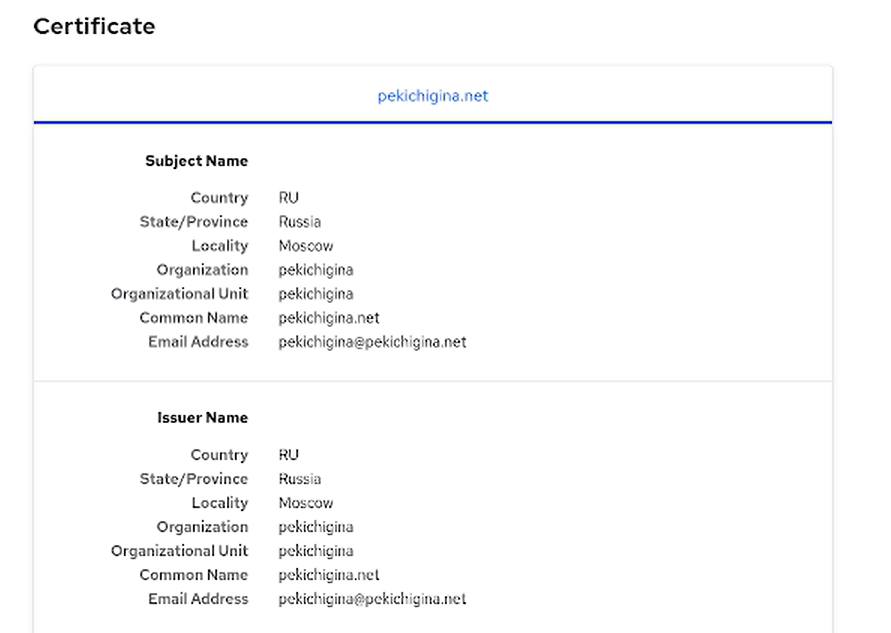
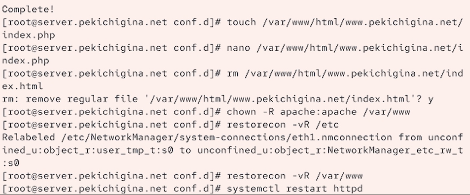

---
## Front matter
lang: ru-RU
title: Лабораторная работа №5
author:
  - Кичигина Полина Евгеньевна
institute:
  - Российский университет дружбы народов, Москва, Россия
date: 03 октября 2026

## i18n babel
babel-lang: russian
babel-otherlangs: english

## Formatting pdf
toc: false
toc-title: Содержание
slide_level: 2
aspectratio: 169
section-titles: true
theme: metropolis
header-includes:
 - \metroset{progressbar=frametitle,sectionpage=progressbar,numbering=fraction}
---

## Цель работы

Приобретение практических навыков по расширенному конфигурированию HTTP-
сервера Apache в части безопасности и возможности использования PHP.

## Задания 

1. Сгенерируйте криптографический ключ и самоподписанный сертификат безопас-
ности для возможности перехода веб-сервера от работы через протокол HTTP
к работе через протокол HTTPS.
2. Настройте веб-сервер для работы с PHP.
3. Напишите (или скорректируйте) скрипт для Vagrant, фиксирующий действия по
расширенной настройке HTTP-сервера во внутреннем окружении виртуальной
машины server.

## Выполнение лабораторной работы

Конфигурирование HTTP-сервера для работы через
протокол HTTPS

Сгенерируйте ключ и сертификат.
Сгенерированные ключ и сертификат появятся в соответствующем каталоге
/etc/ssl/private. Скопируйте сертификат в каталог /etc/ssl/certs
Откройте на редактирование файл /etc/httpd/conf.d/www.user.net.conf и замени-
те его содержимое на следующее (вместо user укажите свой логин)

{#fig:001 width=40%}

##

 Внесите изменения в настройки межсетевого экрана на сервере, разрешив работу
с https. Перезапустите веб-сервер. На виртуальной машине client в строке браузера введите название веб-сервера www.user.net и убедитесь, что произойдёт автома-
тическое переключение на работу по протоколу HTTPS.

{#fig:002 width=50%}

## Конфигурирование HTTP-сервера для работы с PHP

 Установите пакеты для работы с PHP:

В каталоге /var/www/html/www.user.net замените
файл index.html на index.php. Скорректируйте права доступа в каталог с веб-контентом. Восстановите контекст безопасности в SELinux. Перезапустите HTTP-сервер.

{#fig:003 width=60%}

##

На виртуальной машине client в строке браузера введите название веб-сервера
www.user.net (вместо user укажите свой логин) и убедитесь, что будет выведена
страница с информацией об используемой на веб-сервере версии PHP.

{#fig:004 width=60%}

## Внесение изменений в настройки внутреннего окружения виртуальной машины

В имеющийся скрипт /vagrant/provision/server/http.sh внесите изменения, до-
бавив установку PHP и настройку межсетевого экрана, разрешающую работать
с https.

{#fig:005 width=50%}

## Выводы

Мы приобрели практические навыки по расширенному конфигурированию HTTP-
сервера Apache в части безопасности и возможности использования PHP.

## {.standout}

Спасибо за внимание!
