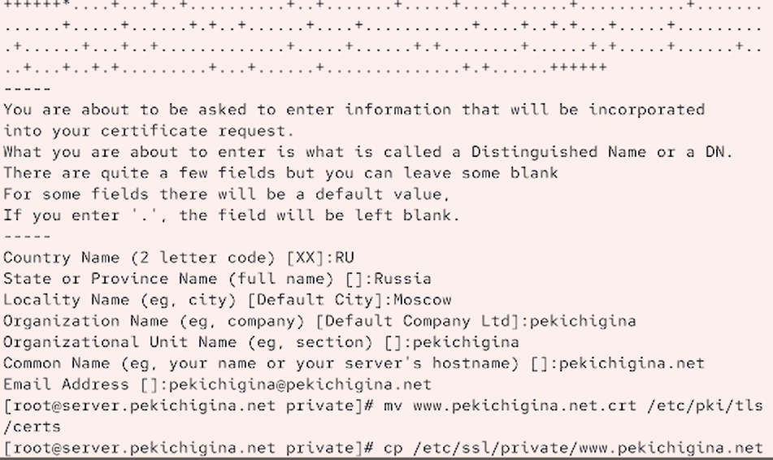
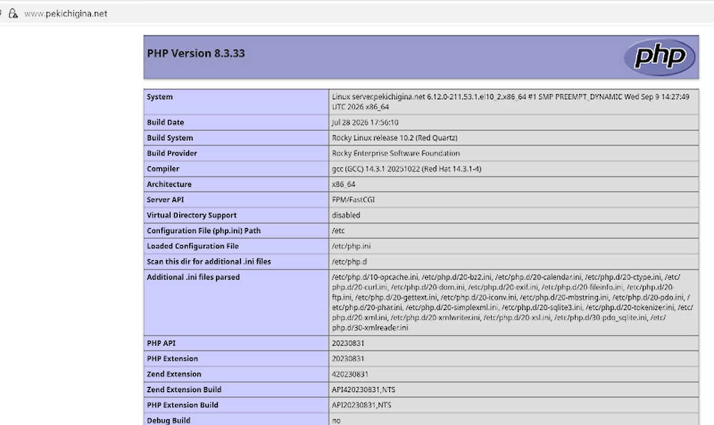
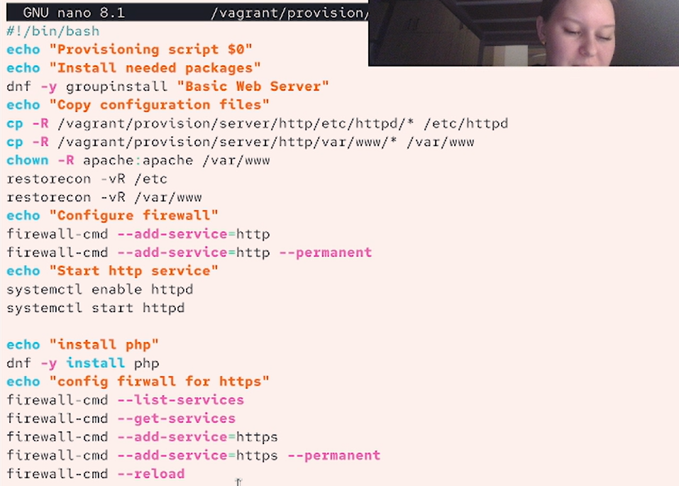

---
## Front matter
title: "Отчёт по лабораторной работе №5"
subtitle: "Отчет"
author: "Кичигина Полина Евгеньевна"

## Generic otions
lang: ru-RU
toc-title: "Содержание"

## Bibliography
bibliography: bib/cite.bib
csl: pandoc/csl/gost-r-7-0-5-2008-numeric.csl

## Pdf output format
toc: true # Table of contents
toc-depth: 2
lof: true # List of figures
lot: true # List of tables
fontsize: 12pt
linestretch: 1.5
papersize: a4
documentclass: scrreprt
## I18n polyglossia
polyglossia-lang:
  name: russian
  options:
	- spelling=modern
	- babelshorthands=true
polyglossia-otherlangs:
  name: english
## I18n babel
babel-lang: russian
babel-otherlangs: english
## Fonts
mainfont: IBM Plex Serif
romanfont: IBM Plex Serif
sansfont: IBM Plex Sans
monofont: IBM Plex Mono
mathfont: STIX Two Math
mainfontoptions: Ligatures=Common,Ligatures=TeX,Scale=0.94
romanfontoptions: Ligatures=Common,Ligatures=TeX,Scale=0.94
sansfontoptions: Ligatures=Common,Ligatures=TeX,Scale=MatchLowercase,Scale=0.94
monofontoptions: Scale=MatchLowercase,Scale=0.94,FakeStretch=0.9
mathfontoptions:
## Biblatex
biblatex: true
biblio-style: "gost-numeric"
biblatexoptions:
  - parentracker=true
  - backend=biber
  - hyperref=auto
  - language=auto
  - autolang=other*
  - citestyle=gost-numeric
## Pandoc-crossref LaTeX customization
figureTitle: "Рис."
tableTitle: "Таблица"
listingTitle: "Листинг"
lofTitle: "Список иллюстраций"
lotTitle: "Список таблиц"
lolTitle: "Листинги"
## Misc options
indent: true
header-includes:
  - \usepackage{indentfirst}
  - \usepackage{float} # keep figures where there are in the text
  - \floatplacement{figure}{H} # keep figures where there are in the text
---

# Цель работы

Приобретение практических навыков по расширенному конфигурированию HTTP-
сервера Apache в части безопасности и возможности использования PHP.

# Задания 

1. Сгенерируйте криптографический ключ и самоподписанный сертификат безопас-
ности для возможности перехода веб-сервера от работы через протокол HTTP
к работе через протокол HTTPS.
2. Настройте веб-сервер для работы с PHP.
3. Напишите (или скорректируйте) скрипт для Vagrant, фиксирующий действия по
расширенной настройке HTTP-сервера во внутреннем окружении виртуальной
машины server.

# Выполнение лабораторной работы

Конфигурирование HTTP-сервера для работы через
протокол HTTPS

1. Загрузите вашу операционную систему и перейдите в рабочий каталог с проектом:
cd /var/tmp/user_name/vagrant
Здесь user_name — идентифицирующее вас имя пользователя, обычно первые буквы
инициалов и фамилия.
2. Запустите виртуальную машину server:
make server-up
(или, если вы работаете под ОС Windows, то vagrant up server).
3. На виртуальной машине server войдите под вашим пользователем и откройте тер-
минал. Перейдите в режим суперпользователя:
sudo -i
4. В каталоге /etc/ssl создайте каталог private:
mkdir -p /etc/pki/tls/private
ln -s /etc/pki/tls/private /etc/ssl/private
cd /etc/pki/tls/private
Сгенерируйте ключ и сертификат, используя следующую команду:
openssl req -x509 -nodes -newkey rsa:2048 -keyout www.user.net.key -out
www.user.net.crt
mv www.user.net.crt /etc/pki/tls/certs
Сгенерированные ключ и сертификат появятся в соответствующем каталоге
/etc/ssl/private. Скопируйте сертификат в каталог /etc/ssl/certs (вместо user
укажите свой логин):
cp /etc/ssl/private/www.user.net.crt /etc/ssl/cert/
5. Для перехода веб-сервера www.user.net на функционирование через протокол
HTTPS требуется изменить его конфигурационный файл. Перейдите в каталог
с конфигурационными файлами:
cd /etc/httpd/conf.d
Откройте на редактирование файл /etc/httpd/conf.d/www.user.net.conf и замени-
те его содержимое на следующее (вместо user укажите свой логин)(рис. [-@fig:001])

{#fig:001 width=70%}

6. Внесите изменения в настройки межсетевого экрана на сервере, разрешив работу
с https:
firewall-cmd --list-services
firewall-cmd --get-services
firewall-cmd --add-service=https
firewall-cmd --add-service=https --permanent
firewall-cmd --reload
7. Перезапустите веб-сервер:
systemctl restart httpd
8. На виртуальной машине client в строке браузера введите название веб-сервера
www.user.net (вместо user укажите свой логин) и убедитесь, что произойдёт автома-
тическое переключение на работу по протоколу HTTPS. На открывшейся странице
с сообщением о незащищённости соединения нажмите кнопку «Дополнительно»,
затем добавьте адрес вашего сервера в постоянные исключения. Затем просмотрите
содержание сертификата (нажмите на значок с замком в адресной строке и кнопку
«Подробнее»).(рис. [-@fig:002])

{#fig:002 width=70%}

Конфигурирование HTTP-сервера для работы с PHP

1. Установите пакеты для работы с PHP:
dnf -y install php
2. В каталоге /var/www/html/www.user.net (вместо user укажите свой логин) замените
файл index.html на index.php следующего содержания:
<?php
phpinfo();
?>
3. Скорректируйте права доступа в каталог с веб-контентом:
chown -R apache:apache /var/www
4. Восстановите контекст безопасности в SELinux:
restorecon -vR /etc
restorecon -vR /var/www
5. Перезапустите HTTP-сервер:
systemctl restart httpd(рис. [-@fig:003])

{#fig:003 width=70%}

6. На виртуальной машине client в строке браузера введите название веб-сервера
www.user.net (вместо user укажите свой логин) и убедитесь, что будет выведена
страница с информацией об используемой на веб-сервере версии PHP.(рис. [-@fig:004])

{#fig:004 width=70%}

Внесение изменений в настройки внутреннего окружения
виртуальной машины

1. На виртуальной машине server перейдите в каталог для внесения изменений
в настройки внутреннего окружения /vagrant/provision/server/http и в соответ-
ствующие каталоги скопируйте конфигурационные файлы:
cp -R /etc/httpd/conf.d/* /vagrant/provision/server/http/etc/httpd/conf.d
cp -R /var/www/html/* /vagrant/provision/server/http/var/www/html
mkdir -p /vagrant/provision/server/http/etc/pki/tls/private
mkdir -p /vagrant/provision/server/http/etc/pki/tls/certs
cp -R /etc/pki/tls/private/www.user.net.key
/vagrant/provision/server/http/etc/pki/tls/private↪
cp -R /etc/pki/tls/certs/www.user.net.crt
/vagrant/provision/server/http/etc/pki/tls/certs↪
2. В имеющийся скрипт /vagrant/provision/server/http.sh внесите изменения, до-
бавив установку PHP и настройку межсетевого экрана, разрешающую работать
с https.(рис. [-@fig:005])

{#fig:005 width=70%}

# Ответы на контрольные вопросы

1. HTTP и HTTPS: HTTP передаёт данные без шифрования, HTTPS — через защищённое TLS-соединение.

2. Безопасность HTTPS: данные шифруются, защищаются от изменения, а сертификат подтверждает подлинность сервера.

3. Сертификационный центр (CA): организация, которая выдаёт и подтверждает цифровые сертификаты. Пример: Let's Encrypt.

# Выводы

Мы приобрели практические навыки по расширенному конфигурированию HTTP-
сервера Apache в части безопасности и возможности использования PHP.
