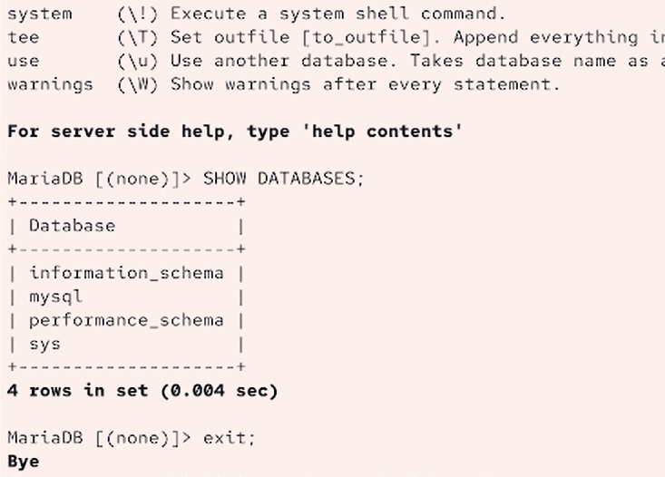
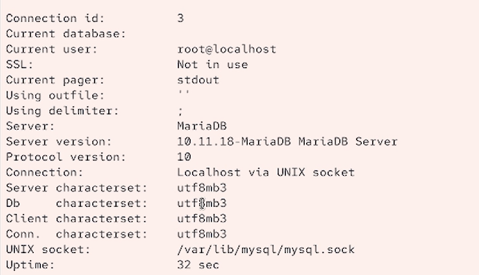
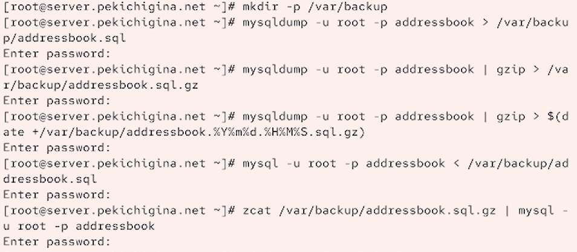
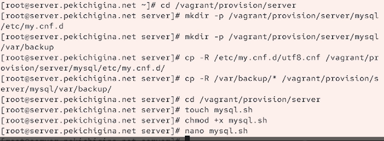
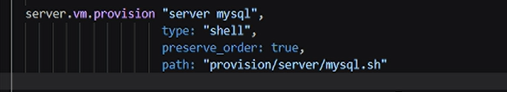

---
## Front matter
lang: ru-RU
title: Лабораторная работа №6
author:
  - Кичигина Полина Евгеньевна
institute:
  - Российский университет дружбы народов, Москва, Россия
date: 9 октябрь 2026

## i18n babel
babel-lang: russian
babel-otherlangs: english

## Formatting pdf
toc: false
toc-title: Содержание
slide_level: 2
aspectratio: 169
section-titles: true
theme: metropolis
header-includes:
 - \metroset{progressbar=frametitle,sectionpage=progressbar,numbering=fraction}
---

## Цель работы

Приобретение практических навыков по установке и конфигурированию системы
управления базами данных на примере программного обеспечения MariaDB.

## Задание

1. Установите необходимые для работы MariaDB пакеты.
2. Настройте в качестве кодировки символов по умолчанию utf8 в базах данных.
3. В базе данных MariaDB создайте тестовую базу addressbook, содержащую таблицу
city с полями name и city, т.е., например, для некоторого сотрудника указан город,
в котором он работает.
4. Создайте резервную копию базы данных addressbook и восстановите из неё данные.
5. Напишите скрипт для Vagrant, фиксирующий действия по установке и настройке
базы данных MariaDB во внутреннем окружении виртуальной машины server. Соответствующим образом следует внести изменения в Vagrantfile.

## Выполнение лабораторной работы Установка MariaDB

В упражнении выполняется базовая установка MariaDB. Также отключается доступ
к базе данных по сети и применяются параметры безопасности. Затем проверяется
наличие доступных системных баз данных по умолчанию. В системе есть information_schema, mysql, performance_schema, sys.

{#fig:001 width=45%}

## Конфигурация кодировки символов

В каталоге /etc/my.cnf.d создайте файл utf8.cnf.
Откройте его на редактирование и укажите в нём  конфигурацию.
Перезапустите MariaDB. Войдите в базу данных с правами администратора и посмотрите статус MariaDB.
В отчёте поясните, что изменилось.

##

Connection id: 12 в 3 — изменился идентификатор подключения.

Кодировка сервера: latin1 в utf8mb3.

Кодировка базы данных: latin1 в utf8mb3.

Uptime: 14 min 37 sec в 32 sec — сервер недавно перезапустили.
 
{#fig:002 width=50%}

## Создание базы данных

Создайте базу данных с именем addressbook. Создайте таблицу city с полями name и city. Заполните несколько строк таблицы некоторыми данными.
В частности, добавьте в базу сведения о Петрове и Сидорове:
Петров, Сочи.
Сидоров, Дубна

{#fig:003 width=45%}

## Резервные копии

На виртуальной машине server создайте каталог для резервных копий. Сделайте резервную копию базы данных addressbook. Сделайте сжатую резервную копию базы данных addressbook. Сделайте сжатую резервную копию базы данных addressbook с указанием даты
создания копии. Восстановите базу данных addressbook из резервной копии.
Восстановите базу данных addressbook из сжатой резервной копии.

{#fig:004 width=55%}

## Внесение изменений в настройки внутреннего окружения виртуальной машины

В каталоге /vagrant/provision/server создайте исполняемый файл mysql.sh.
Открыв его на редактирование, пропишите в нём  скрипт.
Этот скрипт, по сути, повторяет произведённые вами действия по установке и на-
стройке сервера баз данных.

{#fig:005 width=70%}

##
Для отработки созданного скрипта во время загрузки виртуальных машин в кон-
фигурационном файле Vagrantfile необходимо добавить в конфигурации сервера
 запись. 

{#fig:006 width=70%}

## Выводы

Мы приобрели практические навыки по установке и конфигурированию системы
управления базами данных на примере программного обеспечения MariaDB.

