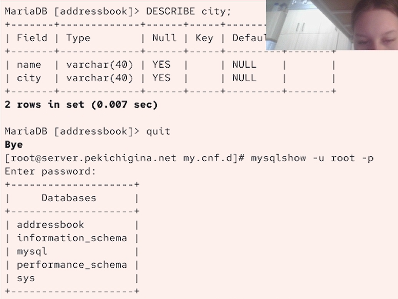

---
## Front matter
title: "Отчет по Лабораторной работе №6"
subtitle: "Отчет"
author: "Кичигина Полина Евгеньевна"

## Generic otions
lang: ru-RU
toc-title: "Содержание"

## Bibliography
bibliography: bib/cite.bib
csl: pandoc/csl/gost-r-7-0-5-2008-numeric.csl

## Pdf output format
toc: true # Table of contents
toc-depth: 2
lof: true # List of figures
lot: true # List of tables
fontsize: 12pt
linestretch: 1.5
papersize: a4
documentclass: scrreprt
## I18n polyglossia
polyglossia-lang:
  name: russian
  options:
	- spelling=modern
	- babelshorthands=true
polyglossia-otherlangs:
  name: english
## I18n babel
babel-lang: russian
babel-otherlangs: english
## Fonts
mainfont: IBM Plex Serif
romanfont: IBM Plex Serif
sansfont: IBM Plex Sans
monofont: IBM Plex Mono
mathfont: STIX Two Math
mainfontoptions: Ligatures=Common,Ligatures=TeX,Scale=0.94
romanfontoptions: Ligatures=Common,Ligatures=TeX,Scale=0.94
sansfontoptions: Ligatures=Common,Ligatures=TeX,Scale=MatchLowercase,Scale=0.94
monofontoptions: Scale=MatchLowercase,Scale=0.94,FakeStretch=0.9
mathfontoptions:
## Biblatex
biblatex: true
biblio-style: "gost-numeric"
biblatexoptions:
  - parentracker=true
  - backend=biber
  - hyperref=auto
  - language=auto
  - autolang=other*
  - citestyle=gost-numeric
## Pandoc-crossref LaTeX customization
figureTitle: "Рис."
tableTitle: "Таблица"
listingTitle: "Листинг"
lofTitle: "Список иллюстраций"
lotTitle: "Список таблиц"
lolTitle: "Листинги"
## Misc options
indent: true
header-includes:
  - \usepackage{indentfirst}
  - \usepackage{float} # keep figures where there are in the text
  - \floatplacement{figure}{H} # keep figures where there are in the text
---

# Цель работы

Приобретение практических навыков по установке и конфигурированию системы
управления базами данных на примере программного обеспечения MariaDB.

# Задание
1. Установите необходимые для работы MariaDB пакеты.
2. Настройте в качестве кодировки символов по умолчанию utf8 в базах данных.
3. В базе данных MariaDB создайте тестовую базу addressbook, содержащую таблицу
city с полями name и city, т.е., например, для некоторого сотрудника указан город,
в котором он работает.
4. Создайте резервную копию базы данных addressbook и восстановите из неё данные.
5. Напишите скрипт для Vagrant, фиксирующий действия по установке и настройке
базы данных MariaDB во внутреннем окружении виртуальной машины server. Соответствующим образом следует внести изменения в Vagrantfile.

# Выполнение лабораторной работы

Установка MariaDB

В упражнении выполняется базовая установка MariaDB. Также отключается доступ
к базе данных по сети и применяются параметры безопасности. Затем проверяется
наличие доступных системных баз данных по умолчанию.

1. Загрузите вашу операционную систему и перейдите в рабочий каталог с проектом:
cd /var/tmp/user_name/vagrant
Здесь user_name — идентифицирующее вас имя пользователя, обычно первые буквы
инициалов и фамилия.
2. Запустите виртуальную машину server:
make server-up
(или, если вы работаете под ОС Windows, то vagrant up server).
3. На виртуальной машине server войдите под вашим пользователем и откройте тер-
минал. Перейдите в режим суперпользователя:
sudo -i
4. Установите необходимые для работы с базами данных пакеты:
dnf -y install mariadb mariadb-server
5. Просмотрите конфигурационные файлы mariadb в каталоге /etc/my.cnf.d и в файле
/etc/my.cnf. В отчёте прокомментируйте построчно их содержание.
6. Для запуска и включения программного обеспечения mariadb используйте:
systemctl start mariadb
systemctl enable mariadb
7. Убедитесь, что mariadb прослушивает порт, используя
ss -tulpen | grep mysql
Вы должны увидеть процесс mysqld, прослушивающий порт 3306.
8. Запустите скрипт конфигурации безопасности mariadb, используя:
mysql_secure_installation
С помощью запустившегося диалога и путём выбора  установите пароль для
пользователя root базы данных (обратите внимание, что это не пользователь root
операционной системы), отключите удалённый корневой доступ и удалите тесто-
вую базу данных и любых анонимных пользователей.
9. Для входа в базу данных с правами администратора базы данных введите
mysql -u root -p
10. Просмотрите список команд MySQL, введя \ h.
11. Из приглашения интерактивной оболочки MariaDB для отображения доступных
в настоящее время баз данных введите MySQL-запрос
SHOW DATABASES;
В отчёте укажите, какие базы данных есть в системе: в системе есть information_schema, mysql, performance_schema, sys.
12. Для выхода из интерфейса интерактивной оболочки MariaDB введите
exit;(рис. [-@fig:001])

{#fig:001 width=70%}

Конфигурация кодировки символов

1. Войдите в базу данных с правами администратора:
mysql -u root -p
2. Для отображения статуса MariaDB введите из приглашения интерактивной оболочки
MariaDB:
status
В отчёте построчно поясните выведенную на экран информацию:
1. Connection id: 12 — уникальный идентификатор текущего подключения к серверу.
2. Current database: — текущая база данных не выбрана.
3. Current user: root\[id5524|@localhost] — пользователь `root`, подключённый с локального компьютера.
4. SSL: Not in use — SSL-шифрование соединения не используется.
5. Current pager: stdout — результаты выводятся напрямую в терминал.
6. Using outfile: '' — файл для вывода результатов не задан.
7. Using delimiter: ; — команды SQL заканчиваются точкой с запятой `;`.
8. Server: MariaDB — используется сервер MariaDB.
9. Server version: 10.11.18-MariaDB MariaDB Server — версия сервера MariaDB — `10.11.18`.
10. Protocol version: 10 — версия протокола взаимодействия клиента с сервером.
11. Connection: Localhost via UNIX socket — подключение выполнено локально через UNIX-сокет, а не через TCP/IP.
12. Server charset: latin1 — кодировка символов по умолчанию на стороне сервера — `latin1`.
13. Db charset: latin1 — кодировка базы данных по умолчанию — `latin1`.
14. Client charset: utf8mb3 — кодировка символов, используемая клиентом; поддерживает символы Unicode в пределах трёх байтов.
15. Conn. charset: utf8mb3 — кодировка, используемая для обмена текстом между клиентом и сервером.
16. UNIX socket: /var/lib/mysql/mysql.sock — путь к файлу сокета, через который устанавливается локальное соединение.
17. Uptime: 14 min 37 sec — сервер работает с момента последнего запуска уже 14 минут 37 секунд.

3. В каталоге /etc/my.cnf.d создайте файл utf8.cnf:
cd /etc/my.cnf.d
touch utf8.cnf
Откройте его на редактирование и укажите в нём  конфигурацию.
4. Перезапустите MariaDB:
systemctl restart mariadb
5. Войдите в базу данных с правами администратора и посмотрите статус MariaDB.
В отчёте поясните, что изменилось:

Connection id: 12 в 3 — изменился идентификатор подключения.

Кодировка сервера: latin1 в utf8mb3.

Кодировка базы данных: latin1 в utf8mb3.

Uptime: 14 min 37 sec в 32 sec — сервер недавно перезапустили.  (рис. [-@fig:002])

{#fig:002 width=70%}

Создание базы данных

1. Войдите в базу данных с правами администратора:
mysql -u root -p
2. Создайте базу данных с именем addressbook:
CREATE DATABASE addressbook CHARACTER SET utf8 COLLATE utf8_general_ci;
3. Перейдите к базе данных addressbook
USE addressbook;
4. Отобразите имеющиеся в базе данных addressbook таблицы:
SHOW TABLES;
5. Создайте таблицу city с полями name и city:
CREATE TABLE city(name VARCHAR(40), city VARCHAR(40));
6. Заполните несколько строк таблицы некоторыми данными по аналогии в соответ-
ствии с синтаксисом MySQL:
INSERT INTO city(name,city) VALUES ('Иванов','Москва');
В частности, добавьте в базу сведения о Петрове и Сидорове:
Петров, Сочи
Сидоров, Дубна
7. Сделайте следующий MySQL-запрос:
SELECT * FROM city;
и в отчёте поясните результат его выполнения.
8. Создайте пользователя для работы с базой данных addressbook (вместо user до знака
@ используйте ваш логин) и задайте для него пароль:
CREATE USER user@'%' IDENTIFIED BY 'password';
9. Предоставьте права доступа созданному пользователю user на действия с базой
данных addressbook (просмотр, добавление, обновление, удаление данных):
GRANT SELECT,INSERT,UPDATE,DELETE ON addressbook.* TO user@'%';
10. Обновите привилегии (права доступа) базы данных addressbook:
FLUSH PRIVILEGES;
11. Посмотрите общую информацию о таблице city базы данных addressbook:
DESCRIBE city;
12. Выйдете из окружения MariaDB:
quit
13. Просмотрите список баз данных:
mysqlshow -u root -p
14. Просмотрите список таблиц базы данных addressbook:
mysqlshow -u root -p addressbook
или
mysqlshow -u user -p addressbook(рис. [-@fig:003])

{#fig:003 width=70%}

Резервные копии

1. На виртуальной машине server создайте каталог для резервных копий:
mkdir -p /var/backup
2. Сделайте резервную копию базы данных addressbook:
mysqldump -u root -p addressbook > /var/backup/addressbook.sql
3. Сделайте сжатую резервную копию базы данных addressbook:
mysqldump -u root -p addressbook | gzip > /var/backup/addressbook.sql.gz
4. Сделайте сжатую резервную копию базы данных addressbook с указанием даты
создания копии:
mysqldump -u root -p addressbook | gzip > $(date
+/var/backup/addressbook.%Y%m%d.%H%M%S.sql.gz)↪
5. Восстановите базу данных addressbook из резервной копии.
6. Восстановите базу данных addressbook из сжатой резервной копии(рис. [-@fig:004])

{#fig:004 width=70%}

Внесение изменений в настройки внутреннего окружения
виртуальной машины

1. На виртуальной машине server перейдите в каталог для внесения изменений
в настройки внутреннего окружения /vagrant/provision/server/, создайте в нём
каталог mysql, в который поместите в соответствующие подкаталоги конфигураци-
онные файлы MariaDB и резервную копию базы данных addressbook:
cd /vagrant/provision/server
mkdir -p /vagrant/provision/server/mysql/etc/my.cnf.d
mkdir -p /vagrant/provision/server/mysql/var/backup
cp -R /etc/my.cnf.d/utf8.cnf
/vagrant/provision/server/mysql/etc/my.cnf.d/↪
cp -R /var/backup/* /vagrant/provision/server/mysql/var/backup/
2. В каталоге /vagrant/provision/server создайте исполняемый файл mysql.sh:
cd /vagrant/provision/server
touch mysql.sh
chmod +x mysql.sh
Открыв его на редактирование, пропишите в нём  скрипт.
Этот скрипт, по сути, повторяет произведённые вами действия по установке и на-
стройке сервера баз данных.(рис. [-@fig:005])

{#fig:005 width=70%}

3. Для отработки созданного скрипта во время загрузки виртуальных машин в кон-
фигурационном файле Vagrantfile необходимо добавить в конфигурации сервера
 запись. (рис. [-@fig:006])

{#fig:006 width=70%}

# Выводы

Мы приобрели практические навыки по установке и конфигурированию системы
управления базами данных на примере программного обеспечения MariaDB.

