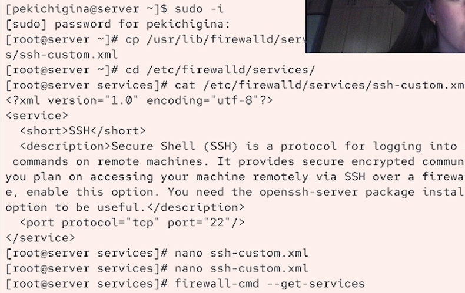
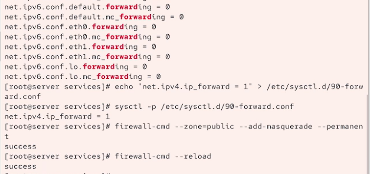
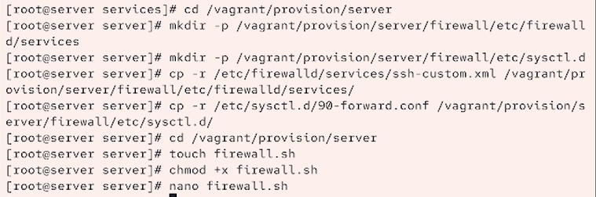

---
## Front matter
lang: ru-RU
title: Лабораторная работа №7
author:
  - Кичигина Полина Евгеньевна
institute:
  - Российский университет дружбы народов, Москва, Россия
date: 16 октября 2026

## i18n babel
babel-lang: russian
babel-otherlangs: english

## Formatting pdf
toc: false
toc-title: Содержание
slide_level: 2
aspectratio: 169
section-titles: true
theme: metropolis
header-includes:
 - \metroset{progressbar=frametitle,sectionpage=progressbar,numbering=fraction}
---

## Цель работы

Получить навыки настройки межсетевого экрана в Linux в части переадресации
портов и настройки Masquerading.

## Задание

1. Настройте межсетевой экран виртуальной машины server для доступа к серверу
по протоколу SSH не через 22-й порт, а через порт 2022.

2. Настройте Port Forwarding на виртуальной машине server.

3. Настройте маскарадинг на виртуальной машине server для организации доступа
клиента к сети Интернет.

4. Напишите скрипт для Vagrant, фиксирующий действия по расширенной настройке
межсетевого экрана. Соответствующим образом внести изменения в Vagrantfile.

## Выполнение лабораторной работы. Создание пользовательской службы firewalld

Откройте файл описания службы на редактирование и замените порт 22 на новый
порт (2022).
В этом же файле скорректируйте описание службы для демонстрации, укажите, что
это модифицированный файл службы. Просмотрите список доступных FirewallD служб.

{#fig:001 width=50%}

##

Перегрузите правила межсетевого экрана с сохранением информации о состоянии
и вновь выведите на экран список служб, а также список активных служб. Добавьте новую службу в FirewallD и выведите на экран список активных служб. Перегрузите правила межсетевого
экрана с сохранением информации о состоянии.

{#fig:002 width=70%}

## Перенаправление портов

Организуйте на сервере переадресацию с порта 2022 на порт 22. На клиенте попробуйте получить доступ по SSH к серверу через порт 2022:
ssh -p 2022 user@server.user.net
(вместо user укажите свой логин).

{#fig:003 width=70%}

## Настройка Port Forwarding и Masquerading

На сервере посмотрите, активирована ли в ядре системы возможность перенаправ-
ления IPv4-пакетов пакетов. Включите перенаправление IPv4-пакетов на сервере. Включите маскарадинг на сервере. На клиенте проверьте доступность выхода в Интернет.

{#fig:004 width=70%}

## Внесение изменений в настройки внутреннего окружения виртуальной машины

На виртуальной машине server перейдите в каталог для внесения изменений
в настройки внутреннего окружения /vagrant/provision/server/, создайте в нём
каталог firewall, в который поместите в соответствующие подкаталоги конфигура-
ционные файлы FirewallD. В каталоге /vagrant/provision/server создайте файл firewall.sh.
Открыв его на редактирование, пропишите в нём  скрипт.

{#fig:005 width=70%}

## Выводы

Мы освоили навыки настройки межсетевого экрана в Linux в части переадресации
портов и настройки Masquerading.
