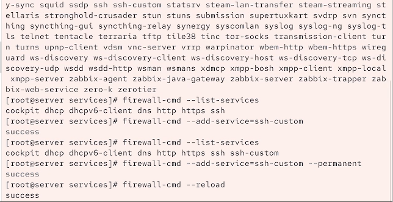
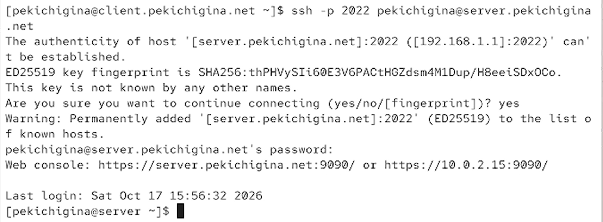

---
## Front matter
title: "Отчет по Лабораторной Работе №7"
subtitle: "Отчет"
author: "Кичигина Полина Евгеньевна"

## Generic otions
lang: ru-RU
toc-title: "Содержание"

## Bibliography
bibliography: bib/cite.bib
csl: pandoc/csl/gost-r-7-0-5-2008-numeric.csl

## Pdf output format
toc: true # Table of contents
toc-depth: 2
lof: true # List of figures
lot: true # List of tables
fontsize: 12pt
linestretch: 1.5
papersize: a4
documentclass: scrreprt
## I18n polyglossia
polyglossia-lang:
  name: russian
  options:
	- spelling=modern
	- babelshorthands=true
polyglossia-otherlangs:
  name: english
## I18n babel
babel-lang: russian
babel-otherlangs: english
## Fonts
mainfont: IBM Plex Serif
romanfont: IBM Plex Serif
sansfont: IBM Plex Sans
monofont: IBM Plex Mono
mathfont: STIX Two Math
mainfontoptions: Ligatures=Common,Ligatures=TeX,Scale=0.94
romanfontoptions: Ligatures=Common,Ligatures=TeX,Scale=0.94
sansfontoptions: Ligatures=Common,Ligatures=TeX,Scale=MatchLowercase,Scale=0.94
monofontoptions: Scale=MatchLowercase,Scale=0.94,FakeStretch=0.9
mathfontoptions:
## Biblatex
biblatex: true
biblio-style: "gost-numeric"
biblatexoptions:
  - parentracker=true
  - backend=biber
  - hyperref=auto
  - language=auto
  - autolang=other*
  - citestyle=gost-numeric
## Pandoc-crossref LaTeX customization
figureTitle: "Рис."
tableTitle: "Таблица"
listingTitle: "Листинг"
lofTitle: "Список иллюстраций"
lotTitle: "Список таблиц"
lolTitle: "Листинги"
## Misc options
indent: true
header-includes:
  - \usepackage{indentfirst}
  - \usepackage{float} # keep figures where there are in the text
  - \floatplacement{figure}{H} # keep figures where there are in the text
---

# Цель работы

Получить навыки настройки межсетевого экрана в Linux в части переадресации
портов и настройки Masquerading.

# Задание

1. Настройте межсетевой экран виртуальной машины server для доступа к серверу
по протоколу SSH не через 22-й порт, а через порт 2022.
2. Настройте Port Forwarding на виртуальной машине server.
3. Настройте маскарадинг на виртуальной машине server для организации доступа
клиента к сети Интернет.
4. Напишите скрипт для Vagrant, фиксирующий действия по расширенной настройке
межсетевого экрана. Соответствующим образом внести изменения в Vagrantfile.

# Выполнение лабораторной работы

Создание пользовательской службы firewalld

1. Загрузите вашу операционную систему и перейдите в рабочий каталог с проектом:
cd /var/tmp/user_name/vagrant
Здесь user_name — идентифицирующее вас имя пользователя, обычно первые буквы
инициалов и фамилия.
2. Запустите виртуальную машину server:
make server-up
(или, если вы работаете под ОС Windows, то vagrant up server).
3. На виртуальной машине server войдите под вашим пользователем и откройте тер-
минал. Перейдите в режим суперпользователя:
sudo -i
4. На основе существующего файла описания службы ssh создайте файл с собственным
описанием:
cp /usr/lib/firewalld/services/ssh.xml
/etc/firewalld/services/ssh-custom.xml↪
cd /etc/firewalld/services/
5. Посмотрите содержимое файла службы:
cat /etc/firewalld/services/ssh-custom.xml
В отчёте построчно прокомментируйте принцип синтаксиса файла описания служ-
бы:
`<?xml version="1.0" encoding="utf-8"?>` — объявляет версию XML и кодировку UTF-8, используемую для хранения текста файла.
 `<service>` — открывает корневой элемент, содержащий описание сетевой службы для `firewalld`.
 `<short>SSH</short>` — задаёт короткое название службы, которое отображается в списках служб брандмауэра.
 `<description>...</description>` — содержит подробное текстовое описание службы SSH, объясняет её назначение для безопасного удалённого подключения и указывает на необходимость установленного пакета `openssh-server`.
 `<port protocol="tcp" port="22"/>` — разрешает для этой службы TCP-порт 22, используемый SSH для удалённого доступа. Атрибут `protocol` задаёт протокол, а `port` — номер порта.
 `</service>` — закрывает корневой элемент XML, завершая описание службы.

6. Откройте файл описания службы на редактирование и замените порт 22 на новый
порт (2022).
В этом же файле скорректируйте описание службы для демонстрации, укажите, что
это модифицированный файл службы.
7. Просмотрите список доступных FirewallD служб:
firewall-cmd --get-services
Обратите внимание, что новая служба ещё не отображается в списке.(рис. [-@fig:001])

{#fig:001 width=70%}

8. Перегрузите правила межсетевого экрана с сохранением информации о состоянии
и вновь выведите на экран список служб, а также список активных служб:

firewall-cmd --reload
firewall-cmd --get-services
firewall-cmd --list-services
Убедитесь, что созданная вами служба отображается в списке доступных для
FirewallD служб, но не активирована.
9. Добавьте новую службу в FirewallD и выведите на экран список активных служб:
firewall-cmd --add-service=ssh-custom
firewall-cmd --list-services
10. Если служба успешно добавлена в FirewallD, то перегрузите правила межсетевого
экрана с сохранением информации о состоянии.(рис. [-@fig:002])

{#fig:002 width=70%}

Перенаправление портов

1. Организуйте на сервере переадресацию с порта 2022 на порт 22:
firewall-cmd --add-forward-port=port=2022:proto=tcp:toport=22
2. На клиенте попробуйте получить доступ по SSH к серверу через порт 2022:
ssh -p 2022 user@server.user.net
(вместо user укажите свой логин). (рис. [-@fig:003])

{#fig:003 width=70%}

Настройка Port Forwarding и Masquerading

1. На сервере посмотрите, активирована ли в ядре системы возможность перенаправ-
ления IPv4-пакетов пакетов:
sysctl -a | grep forward
2. Включите перенаправление IPv4-пакетов на сервере:
echo "net.ipv4.ip_forward = 1" > /etc/sysctl.d/90-forward.conf
sysctl -p /etc/sysctl.d/90-forward.conf
3. Включите маскарадинг на сервере:
firewall-cmd --zone=public --add-masquerade --permanent
firewall-cmd --reload
4. На клиенте проверьте доступность выхода в Интернет.(рис. [-@fig:004])

{#fig:004 width=70%}

Внесение изменений в настройки внутреннего окружения
виртуальной машины

1. На виртуальной машине server перейдите в каталог для внесения изменений
в настройки внутреннего окружения /vagrant/provision/server/, создайте в нём
каталог firewall, в который поместите в соответствующие подкаталоги конфигура-
ционные файлы FirewallD:
cd /vagrant/provision/server
mkdir -p /vagrant/provision/server/firewall/etc/firewalld/services
mkdir -p /vagrant/provision/server/firewall/etc/sysctl.d
cp -r /etc/firewalld/services/ssh-custom.xml
/vagrant/provision/server/firewall/etc/firewalld/services/↪
cp -r /etc/sysctl.d/90-forward.conf
/vagrant/provision/server/firewall/etc/sysctl.d/↪
2. В каталоге /vagrant/provision/server создайте файл firewall.sh:
cd /vagrant/provision/server
touch firewall.sh
chmod +x firewall.sh
Открыв его на редактирование, пропишите в нём  скрипт.
3. Для отработки созданного скрипта во время загрузки виртуальной машины server
в конфигурационном файле Vagrantfile необходимо добавить в разделе конфигу-
рации для сервера.(рис. [-@fig:005])

{#fig:005 width=70%}

# Выводы

Мы освоили навыки настройки межсетевого экрана в Linux в части переадресации
портов и настройки Masquerading.

# Ответы на контрольные вопросы

1. `/etc/firewalld/`
2. `<port port="2022" protocol="tcp"/>`
3. `firewall-cmd --get-services`
4. Маскарадинг — частный случай NAT (SNAT), автоматически подставляет IP исходящего интерфейса; NAT требует явного указания адреса.
5. `firewall-cmd --permanent --zone=public --add-forward-port=port=4404:proto=tcp:toport=22:toaddr=10.0.0.10`
6. `firewall-cmd --permanent --zone=public --add-masquerade`

