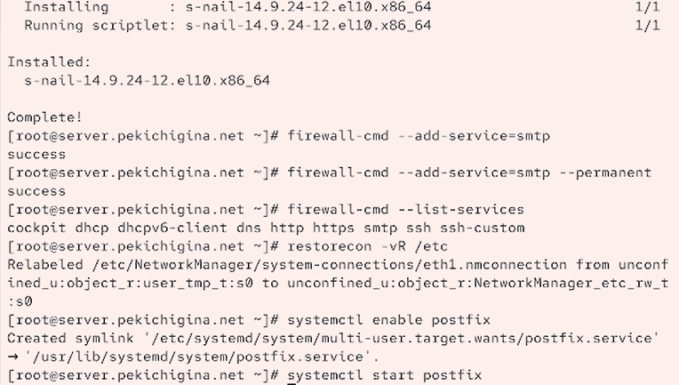
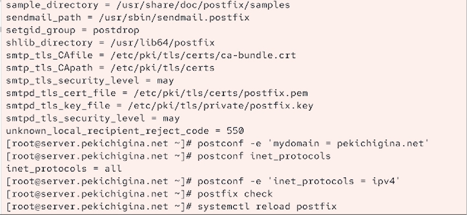
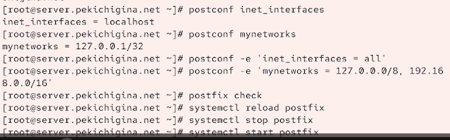
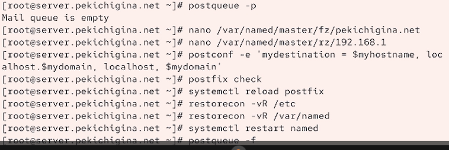
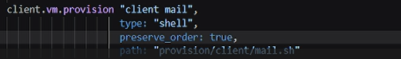

---
## Front matter
lang: ru-RU
title: Лабораторная работа №8
author:
  - Кичигина Полина Евгеньевна
institute:
  - Российский университет дружбы народов, Москва, Россия
date: 24 октября 2026

## i18n babel
babel-lang: russian
babel-otherlangs: english

## Formatting pdf
toc: false
toc-title: Содержание
slide_level: 2
aspectratio: 169
section-titles: true
theme: metropolis
header-includes:
 - \metroset{progressbar=frametitle,sectionpage=progressbar,numbering=fraction}
---

## Цель работы

Приобретение практических навыков по установке и конфигурированию SMTP-
сервера.

## Задание

1. Установите на виртуальной машине server SMTP-сервер postfix.
2. Сделайте первоначальную настройку postfix при помощи утилиты postconf, задав
отправку писем не на локальный хост, а на сервер в домене.
3. Проверьте отправку почты с сервера и клиента.
4. Сконфигурируйте Postfix для работы в домене. Проверьте отправку почты с сервера
и клиента.
5. Напишите скрипт для Vagrant, фиксирующий действия по установке и настройке
Postfix во внутреннем окружении виртуальной машины server. Соответствующим
образом внесите изменения в Vagrantfile.

## Выполнение лабораторной работы. Установка Postfix

Установите необходимые для работы пакеты. Сконфигурируйте межсетевой экран, разрешив работать службе протокола SMTP. Восстановите контекст безопасности в SELinux. Запустите Postfix.

{#fig:001 width=60%}

## Изменение параметров Postfix с помощью postconf

Первоначальную настройку Postfix осуществите, используя postconf.

{#fig:002 width=70%}

## Проверка работы Postfix

Разрешите Postfix прослушивать соединения не только с локального узла, но и с дру-
гих интерфейсов сети. Добавьте адрес внутренней сети, разрешив таким образом пересылку сообщений
между узлами сети. Перезагрузите конфигурацию Postfix и перезапустите Postfix.

{#fig:003 width=70%}

## Конфигурация Postfix для домена

С клиента отправьте письмо на свой доменный адрес. В конфигурации Postfix добавьте домен в список элементов сети, для которых данный сервер является конечной точкой доставки почты. Перезагрузите конфигурацию Postfix. Восстановите контекст безопасности в SELinux. Перезапустите DNS:
Попробуйте отправить сообщения, находящиеся в очереди на отправление.

{#fig:004 width=70%}

## Внесение изменений в настройки внутреннего окружения виртуальной машины

Для отработки созданного скрипта во время загрузки виртуальной машины client
в конфигурационном файле Vagrantfile необходимо добавить в разделе конфигу-
рации для клиента.

{#fig:005 width=70%}

## Выводы

Мы приобрели практические навыки по установке и конфигурированию SMTP-
сервера.
