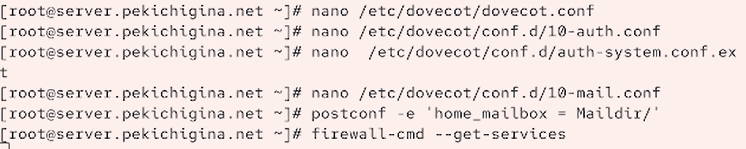
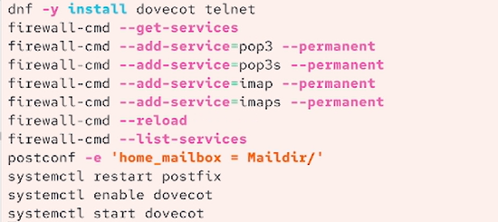

---
## Front matter
lang: ru-RU
title: Лабораторная работа №9
author:
  - Кичигина Полина Евгеньевна
institute:
  - Российский университет дружбы народов, Москва, Россия
date: 31 октября 2026

## i18n babel
babel-lang: russian
babel-otherlangs: english

## Formatting pdf
toc: false
toc-title: Содержание
slide_level: 2
aspectratio: 169
section-titles: true
theme: metropolis
header-includes:
 - \metroset{progressbar=frametitle,sectionpage=progressbar,numbering=fraction}
---

## Цель работы

Приобретение практических навыков по установке и простейшему конфигурированию POP3/IMAP-сервера.

## Задание

1. Установите на виртуальной машине server Dovecot и Telnet для дальнейшей про-
верки корректности работы почтового сервера.
2. Настройте Dovecot.
3. Установите на виртуальной машине client программу для чтения почты Evolution
и настройте её для манипуляций с почтой вашего пользователя. Проверьте кор-
ректность работы почтового сервера как с виртуальной машины server, так
и с виртуальной машины client.
4. Измените скрипт для Vagrant, фиксирующий действия по установке и настройке
Postfix и Dovecote во внутреннем окружении виртуальной машины server, создайте
скрипт для Vagrant, фиксирующий действия по установке Evolution во внутрен-
нем окружении виртуальной машины client. Соответствующим образом внесите
изменения в Vagrantfile.

## Выполнение лабораторной работы. Установка Dovecot

На виртуальной машине server войдите под вашим пользователем и откройте тер-
минал. Перейдите в режим суперпользователя. Установите необходимые для работы пакеты.

{#fig:001 width=58%}

## Настройка dovecot

В конфигурационном файле /etc/dovecot/dovecot.conf пропишите список почто-
вых протоколов, по которым разрешено работать Dovecot. В конфигурационном файле /etc/dovecot/conf.d/10-auth.conf проверьте, что указан метод аутентификации plain.
 Сконфигурируйте межсетевой экран, разрешив работать службам протоколов POP3
и IMAP.

{#fig:002 width=70%}

##

Восстановите контекст безопасности в SELinux. Перезапустите Postfix и запустите Dovecot.

{#fig:003 width=70%}

## Проверка работы Dovecot

На виртуальной машине client войдите под вашим пользователем и откройте терминал. Установите почтовый клиент. Из почтового клиента отправьте себе несколько тестовых писем, убедитесь, что они
доставлены. Параллельно посмотрите, какие сообщения выдаются при мониторинге почтовой
службы на сервере, а также при использовании doveadm и mail.

{#fig:004 width=46%}

## Внесение изменений в настройки внутреннего окружения виртуальной машины

 Внесите изменения в файл /vagrant/provision/server/mail.sh, добавив в него
строки: по установке Dovecot и Telnet; по настройке межсетевого экрана; по настройке Postfix в части задания месторасположения почтового ящика; по перезапуску Postfix и запуску Dovecot.

{#fig:005 width=70%}

## Выводы

Мы приобрели практические навыки по установке и простейшему конфигурированию POP3/IMAP-сервера.
