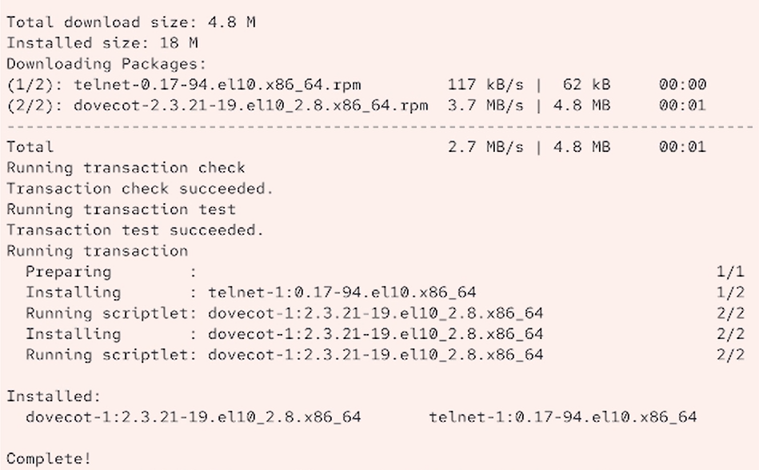
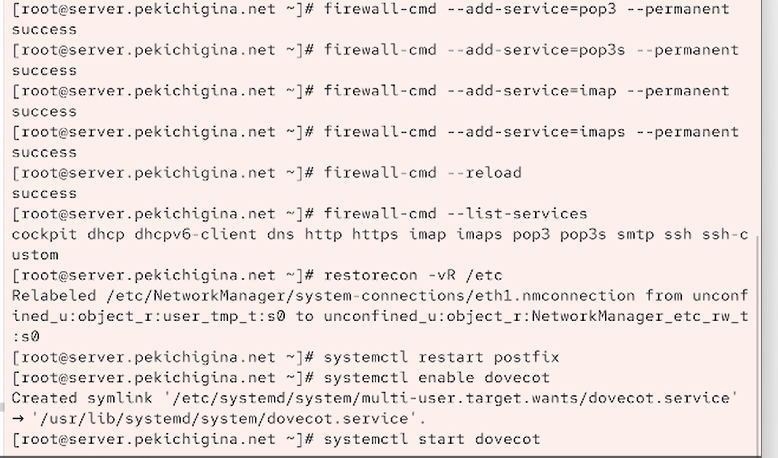
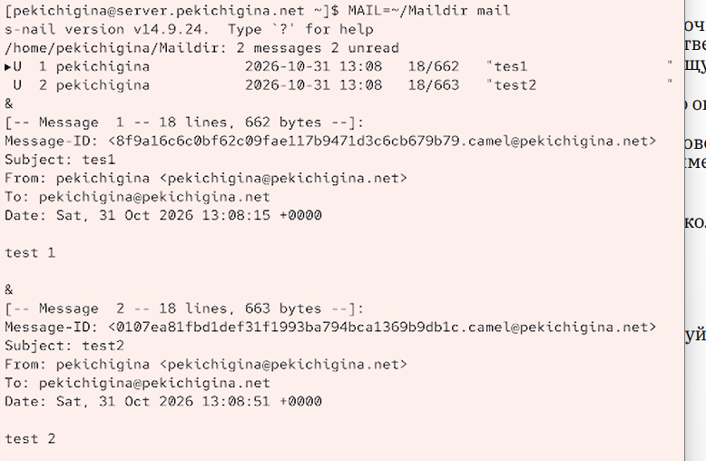

---
## Front matter
title: "Отчёт по лабораторной работе №9"
subtitle: "Отчет"
author: "Кичигина Полина Евгеньевна"

## Generic otions
lang: ru-RU
toc-title: "Содержание"

## Bibliography
bibliography: bib/cite.bib
csl: pandoc/csl/gost-r-7-0-5-2008-numeric.csl

## Pdf output format
toc: true # Table of contents
toc-depth: 2
lof: true # List of figures
lot: true # List of tables
fontsize: 12pt
linestretch: 1.5
papersize: a4
documentclass: scrreprt
## I18n polyglossia
polyglossia-lang:
  name: russian
  options:
	- spelling=modern
	- babelshorthands=true
polyglossia-otherlangs:
  name: english
## I18n babel
babel-lang: russian
babel-otherlangs: english
## Fonts
mainfont: IBM Plex Serif
romanfont: IBM Plex Serif
sansfont: IBM Plex Sans
monofont: IBM Plex Mono
mathfont: STIX Two Math
mainfontoptions: Ligatures=Common,Ligatures=TeX,Scale=0.94
romanfontoptions: Ligatures=Common,Ligatures=TeX,Scale=0.94
sansfontoptions: Ligatures=Common,Ligatures=TeX,Scale=MatchLowercase,Scale=0.94
monofontoptions: Scale=MatchLowercase,Scale=0.94,FakeStretch=0.9
mathfontoptions:
## Biblatex
biblatex: true
biblio-style: "gost-numeric"
biblatexoptions:
  - parentracker=true
  - backend=biber
  - hyperref=auto
  - language=auto
  - autolang=other*
  - citestyle=gost-numeric
## Pandoc-crossref LaTeX customization
figureTitle: "Рис."
tableTitle: "Таблица"
listingTitle: "Листинг"
lofTitle: "Список иллюстраций"
lotTitle: "Список таблиц"
lolTitle: "Листинги"
## Misc options
indent: true
header-includes:
  - \usepackage{indentfirst}
  - \usepackage{float} # keep figures where there are in the text
  - \floatplacement{figure}{H} # keep figures where there are in the text
---

# Цель работы

Приобретение практических навыков по установке и простейшему конфигурированию POP3/IMAP-сервера.

# Задание

1. Установите на виртуальной машине server Dovecot и Telnet для дальнейшей про-
верки корректности работы почтового сервера.
2. Настройте Dovecot.
3. Установите на виртуальной машине client программу для чтения почты Evolution
и настройте её для манипуляций с почтой вашего пользователя. Проверьте кор-
ректность работы почтового сервера как с виртуальной машины server, так
и с виртуальной машины client.
4. Измените скрипт для Vagrant, фиксирующий действия по установке и настройке
Postfix и Dovecote во внутреннем окружении виртуальной машины server, создайте
скрипт для Vagrant, фиксирующий действия по установке Evolution во внутрен-
нем окружении виртуальной машины client. Соответствующим образом внесите
изменения в Vagrantfile.

# Выполнение лабораторной работы

Установка Dovecot

1. На виртуальной машине server войдите под вашим пользователем и откройте тер-
минал. Перейдите в режим суперпользователя:

sudo -i

2. Установите необходимые для работы пакеты:
dnf -y install dovecot telnet(рис. [-@fig:001])

{#fig:001 width=70%}

Настройка dovecot

1. В конфигурационном файле /etc/dovecot/dovecot.conf пропишите список почто-
вых протоколов, по которым разрешено работать Dovecot:
protocols = imap pop3
2. В конфигурационном файле /etc/dovecot/conf.d/10-auth.conf проверьте, что ука-
зан метод аутентификации plain:
auth_mechanisms = plain
3. В конфигурационном файле /etc/dovecot/conf.d/auth-system.conf.ext проверьте,
что для поиска пользователей и их паролей используется pam и файл passwd.
4. В конфигурационном файле /etc/dovecot/conf.d/10-mail.conf настройте место-
расположение почтовых ящиков пользователей:
mail_location = maildir:~/Maildir
5. В Postfix задайте каталог для доставки почты:
postconf -e 'home_mailbox = Maildir/'
6. Сконфигурируйте межсетевой экран, разрешив работать службам протоколов POP3
и IMAP:(рис. [-@fig:002])

{#fig:002 width=70%}

7. Восстановите контекст безопасности в SELinux:
restorecon -vR /etc
8. Перезапустите Postfix и запустите Dovecot:(рис. [-@fig:003])

{#fig:003 width=70%}

Проверка работы Dovecot

1. На дополнительном терминале виртуальной машины server запустите мониторинг
работы почтовой службы:
tail -f /var/log/maillog
2. На терминале сервера для просмотра имеющейся почты используйте
MAIL=~/Maildir mail
3. Для просмотра mailbox пользователя на сервере на терминале с правами супер-
пользователя используйте команду
doveadm mailbox list -u user
(вместо user укажите свой логин).
4. На виртуальной машине client войдите под вашим пользователем и откройте тер-
минал. Перейдите в режим суперпользователя:
sudo -i
74 Лабораторная работа № 9
5. Установите почтовый клиент:
dnf -y install evolution
6. Запустите и настройте почтовый клиент Evolution:
– в окне настройки учётной записи почты укажите имя, адрес почты в виде
user@user.net (вместо user укажите свой логин), введите пароль вашего пользо-
вателя, нажмите «Продолжить», затем нажмите «Настроить вручную»;
– в качестве IMAP-сервера для входящих сообщений и SMTP-сервера для ис-
ходящих сообщений пропишите mail.user.net, в качестве пользователя для
входящих и исходящих сообщений укажите user (вместо user укажите свой ло-
гин);
– проверьте номера портов: для IMAP — порт 143, для SMTP — порт 25;
– проверьте настройки SSL и метода аутентификации: для IMAP — STARTTLS,
аутентификация по обычному паролю, для SMTP — без аутентификации, аутен-
тификация — «Без аутентификации»;
– при возникновении сообщения о небезопасном соединении выставьте галочку
о понимании риска работы по такому соединению и нажмите «Ок», затем подтвер-
дите исключение безопасности, нажав в появившемся окне соответствующую
кнопку.
7. Из почтового клиента отправьте себе несколько тестовых писем, убедитесь, что они
доставлены.
8. Параллельно посмотрите, какие сообщения выдаются при мониторинге почтовой
службы на сервере, а также при использовании doveadm и mail.(рис. [-@fig:004])

{#fig:004 width=70%}

9. Проверьте работу почтовой службы, используя на сервере протокол Telnet:
– подключитесь с помощью протокола Telnet к почтовому серверу по протоколу
POP3 (через порт 110), введите свой логин для подключения и пароль:
telnet mail.user.net 110
user имя_пользователя
pass ваш_пароль
(в названии почтового сервера и в имени пользователя вместо user используйте
свой логин);
– с помощью команды list получите список писем;
– с помощью команды retr 1 получите первое письмо из списка;
– с помощью команды dele 2 удалите второе письмо из списка;
– с помощью команды quit завершите сеанс работы с telnet.

Внесение изменений в настройки внутреннего окружения
виртуальной машины

1. На виртуальной машине server перейдите в каталог для внесения изменений в на-
стройки внутреннего окружения /vagrant/provision/server/. В соответствующие
подкаталоги поместите конфигурационные файлы Dovecot.
2. Внесите изменения в файл /vagrant/provision/server/mail.sh, добавив в него
строки:
– по установке Dovecot и Telnet;
– по настройке межсетевого экрана;
– по настройке Postfix в части задания месторасположения почтового ящика;
– по перезапуску Postfix и запуску Dovecot.(рис. [-@fig:005])

{#fig:005 width=70%}

3. На виртуальной машине client в каталоге /vagrant/provision/client скорректи-
руйте файл mail.sh, прописав в нём:
dnf -y install evolution

# Выводы

Мы приобрели практические навыки по установке и простейшему конфигурированию POP3/IMAP-сервера.
