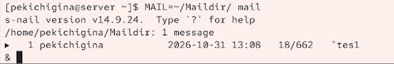
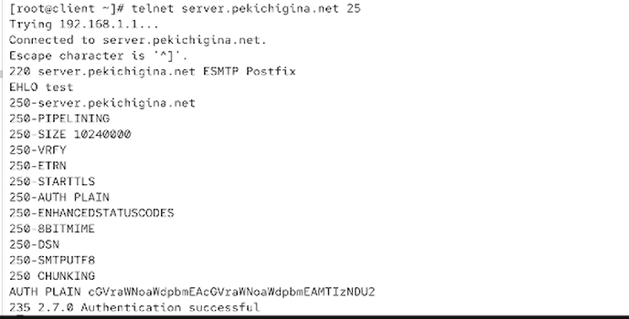
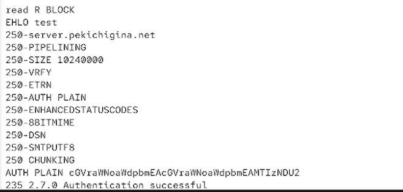
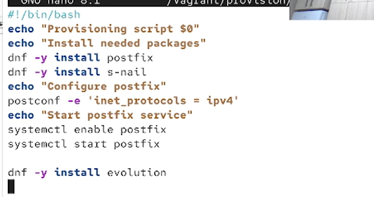

---
## Front matter
lang: ru-RU
title: Лабораторная работа №10
author:
  - Кичигина Полина Евгеньевна
institute:
  - Российский университет дружбы народов, Москва, Россия
date: 8 ноября 2025

## i18n babel
babel-lang: russian
babel-otherlangs: english

## Formatting pdf
toc: false
toc-title: Содержание
slide_level: 2
aspectratio: 169
section-titles: true
theme: metropolis
header-includes:
 - \metroset{progressbar=frametitle,sectionpage=progressbar,numbering=fraction}
---

## Цель работы

Приобретение практических навыков по конфигурированию SMTP-сервера в части
настройки аутентификации.

## Задание

1. Настройте Dovecot для работы с LMTP.

2. Настройте аутентификацию посредством SASL на SMTP-сервере.

3. Настройте работу SMTP-сервера поверх TLS.

4. Скорректируйте скрипт для Vagrant, фиксирующий действия расширенной на
стройки SMTP-сервера во внутреннем окружении виртуальной машины server.

## Настройка LMTP в Dovecot.

В этом разделе мы настроили Dovecot для работы с протоколом LMTP, добавив его в список поддерживаемых протоколов и создав unix-сокет для связи с Postfix. Также мы перенастроили Postfix на передачу сообщений через этот сокет и проверили успешную локальную доставку письма в почтовый ящик пользователя. 

{#fig:001 width=70%}

## Настройка SMTP-аутентификации.

Здесь мы настроили механизм аутентификации SASL, определив в Dovecot службу auth и связав её с Postfix через unix-сокет. Мы также ограничили список сетей, с которых разрешено принимать почту, и протестировали аутентификацию на 25-м порту с помощью telnet и закодированной в base64 строки логина и пароля.

{#fig:002 width=60%}

## Настройка SMTP over TLS.

В этом разделе мы настроили шифрование трафика (TLS), скопировав сертификаты Dovecot и указав пути к ним в конфигурации Postfix. Дополнительно мы активировали порт 587 (submission) с обязательным шифрованием, открыли его в межсетевом экране и проверили подключение с клиента через openssl.

{#fig:003 width=60%}

## Внесение изменений в настройки внутреннего окружения виртуальной машины.
В заключительном разделе мы перенесли все измененные конфигурационные файлы Dovecot и Postfix в директорию Vagrant для автоматизации развертывания. Мы отредактировали bash-скрипт mail.sh, добавив в него установку пакетов, настройку firewall, запуск служб и применение всех необходимых параметров конфигурации.

{#fig:004 width=60%}

## Выводы

Мы приобрели практические навыки по конфигурированию SMTP-сервера в части
настройки аутентификации.
