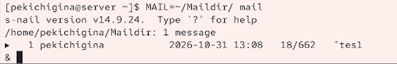
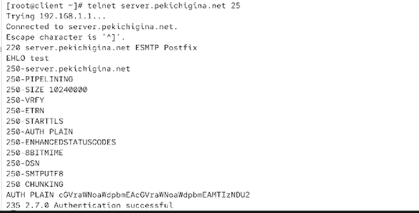
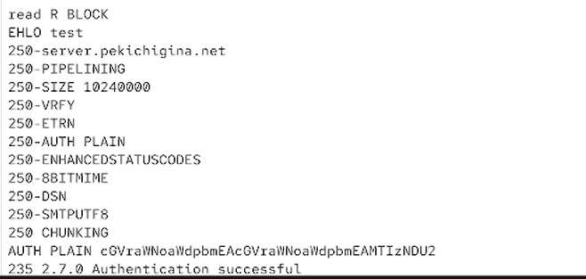
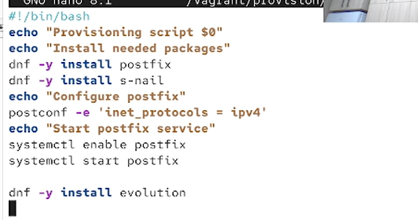

---
## Front matter
title: "Отчёт по лабораторной работе №10"
subtitle: "Отчет"
author: "Кичигина Полина Евгеньевна"

## Generic otions
lang: ru-RU
toc-title: "Содержание"

## Bibliography
bibliography: bib/cite.bib
csl: pandoc/csl/gost-r-7-0-5-2008-numeric.csl

## Pdf output format
toc: true # Table of contents
toc-depth: 2
lof: true # List of figures
lot: true # List of tables
fontsize: 12pt
linestretch: 1.5
papersize: a4
documentclass: scrreprt
## I18n polyglossia
polyglossia-lang:
  name: russian
  options:
	- spelling=modern
	- babelshorthands=true
polyglossia-otherlangs:
  name: english
## I18n babel
babel-lang: russian
babel-otherlangs: english
## Fonts
mainfont: IBM Plex Serif
romanfont: IBM Plex Serif
sansfont: IBM Plex Sans
monofont: IBM Plex Mono
mathfont: STIX Two Math
mainfontoptions: Ligatures=Common,Ligatures=TeX,Scale=0.94
romanfontoptions: Ligatures=Common,Ligatures=TeX,Scale=0.94
sansfontoptions: Ligatures=Common,Ligatures=TeX,Scale=MatchLowercase,Scale=0.94
monofontoptions: Scale=MatchLowercase,Scale=0.94,FakeStretch=0.9
mathfontoptions:
## Biblatex
biblatex: true
biblio-style: "gost-numeric"
biblatexoptions:
  - parentracker=true
  - backend=biber
  - hyperref=auto
  - language=auto
  - autolang=other*
  - citestyle=gost-numeric
## Pandoc-crossref LaTeX customization
figureTitle: "Рис."
tableTitle: "Таблица"
listingTitle: "Листинг"
lofTitle: "Список иллюстраций"
lotTitle: "Список таблиц"
lolTitle: "Листинги"
## Misc options
indent: true
header-includes:
  - \usepackage{indentfirst}
  - \usepackage{float} # keep figures where there are in the text
  - \floatplacement{figure}{H} # keep figures where there are in the text
---

# Цель работы

Приобретение практических навыков по конфигурированию SMTP-сервера в части
настройки аутентификации.

# Задание

1. Настройте Dovecot для работы с LMTP.
2. Настройте аутентификацию посредством SASL на SMTP-сервере.
3. Настройте работу SMTP-сервера поверх TLS.
4. Скорректируйте скрипт для Vagrant, фиксирующий действия расширенной на
стройки SMTP-сервера во внутреннем окружении виртуальной машины server.

# Выполнение лабораторной работы.

1. Настройка LMTP в Dovecot.

В этом разделе мы настроили Dovecot для работы с протоколом LMTP, добавив его в список поддерживаемых протоколов и создав unix-сокет для связи с Postfix. Также мы перенастроили Postfix на передачу сообщений через этот сокет и проверили успешную локальную доставку письма в почтовый ящик пользователя. (рис. [-@fig:001])

{#fig:001 width=70%}

2. Настройка SMTP-аутентификации.

Здесь мы настроили механизм аутентификации SASL, определив в Dovecot службу auth и связав её с Postfix через unix-сокет. Мы также ограничили список сетей, с которых разрешено принимать почту, и протестировали аутентификацию на 25-м порту с помощью telnet и закодированной в base64 строки логина и пароля. (рис. [-@fig:002]).

{#fig:002 width=70%}

3. Настройка SMTP over TLS.

В этом разделе мы настроили шифрование трафика (TLS), скопировав сертификаты Dovecot и указав пути к ним в конфигурации Postfix. Дополнительно мы активировали порт 587 (submission) с обязательным шифрованием, открыли его в межсетевом экране и проверили подключение с клиента через openssl.(рис. [-@fig:003])

{#fig:003 width=70%}

4. Внесение изменений в настройки внутреннего окружения виртуальной машины.
В заключительном разделе мы перенесли все измененные конфигурационные файлы Dovecot и Postfix в директорию Vagrant для автоматизации развертывания. Мы отредактировали bash-скрипт mail.sh, добавив в него установку пакетов, настройку firewall, запуск служб и применение всех необходимых параметров конфигурации.(рис. [-@fig:004])

{#fig:004 width=70%}

# Выводы

Мы приобрели практические навыки по конфигурированию SMTP-сервера в части
настройки аутентификации.
