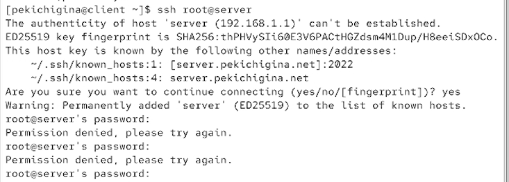
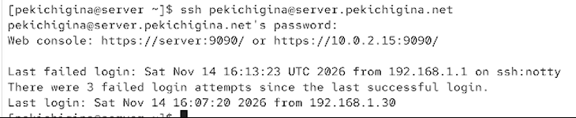
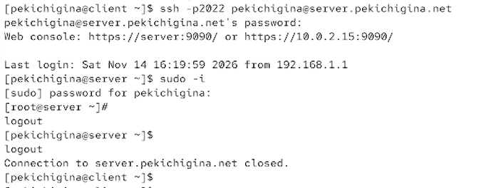
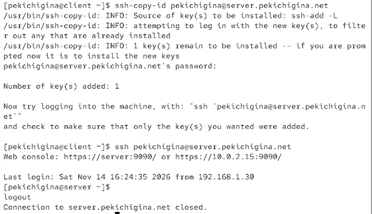
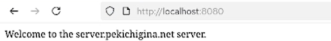
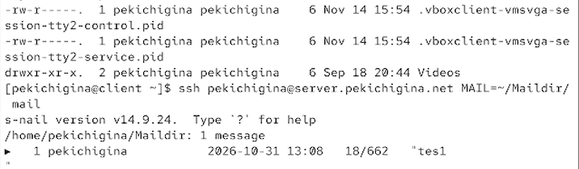
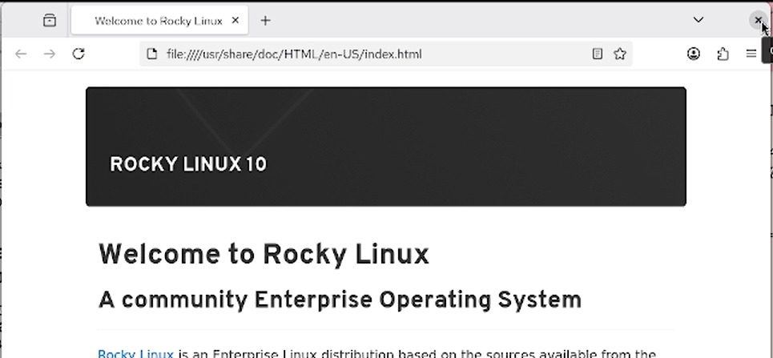
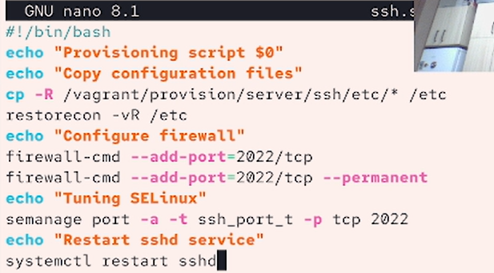

---
## Front matter
lang: ru-RU
title: Лабораторная работа №11
author:
  - Кичигина Полина Евгеньевна
institute:
  - Российский университет дружбы народов, Москва, Россия
date: 14 ноября 2026

## i18n babel
babel-lang: russian
babel-otherlangs: english

## Formatting pdf
toc: false
toc-title: Содержание
slide_level: 2
aspectratio: 169
section-titles: true
theme: metropolis
header-includes:
 - \metroset{progressbar=frametitle,sectionpage=progressbar,numbering=fraction}
---

## Цель работы

Приобретение практических навыков по настройке удалённого доступа к серверу
с помощью SSH.

## Задание

1. Настройте запрет удалённого доступа на сервер по SSH для пользователя root.
2. Настройте разрешение удалённого доступа к серверу по SSH только для пользователей группы vagrant и вашего пользователя.
3. Настройте удалённый доступ к серверу по SSH через порт 2022.
4. Настройте удалённый доступ к серверу по SSH по ключу.
5. Организуйте SSH-туннель с клиента на сервер, перенаправив локальное соединение с TCP-порта 80 на порт 8080.

##

6. Используя удалённое SSH-соединение, выполните с клиента несколько команд на сервере.
7. Используя удалённое SSH-соединение, запустите с клиента графическое приложение на сервере.
8. Напишите скрипт для Vagrant, фиксирующий действия по настройке SSH-сервера
во внутреннем окружении виртуальной машины server. Соответствующим образом
внесите изменения в Vagrantfile.

## Выполнение лабораторной работы. Запрет удалённого доступа по SSH для пользователя root

Задали пароль root и запустили мониторинг journalctl -x -f, а с клиента попытались войти как root@server — получили запрос пароля и отказ после неверных попыток. Затем установили PermitRootLogin no, перезапустили sshd и повторили вход под root, который был отклонён ещё до проверки пароля.

{#fig:001 width=65%}

## Ограничение списка пользователей для удалённого доступа по SSH

С клиента успешно вошли под pekichigina, затем на сервере добавили AllowUsers vagrant и перезапустили sshd. Повторный вход под pekichigina был отклонён, после изменения строки на AllowUsers vagrant pekichigina и перезапуска вход снова стал успешным.

{#fig:002 width=70%}

## Настройка дополнительных портов для удалённого доступа по SSH

Добавили Port 22 и Port 2022, перезапустили sshd и по статусу и журналу увидели отказ работы через порт 2022 из-за SELinux и firewall. После разметки порта 2022 в SELinux и открытия его в firewall перезапустили sshd и успешно подключились через порты 22 и 2022.

{#fig:003 width=70%}

## Настройка удалённого доступа по SSH по ключу

Включили PubkeyAuthentication yes и перезапустили sshd, затем на клиенте сгенерировали пару ключей через ssh-keygen без кодовой фразы. Скопировали открытый ключ на сервер через ssh-copy-id, после чего вход выполнялся без запроса пароля.

{#fig:004 width=55%}

## Организация туннелей SSH, перенаправление TCP-портов

Посмотрели TCP-соединения через lsof | grep TCP, затем выполнили ssh -fNL 8080:localhost:80 user@server... для фоновой переадресации порта 8080 на порт 80 сервера. Повторно проверили lsof (появился процесс ssh на 8080) и открыли в браузере localhost:8080, где отобразилась страница сервера.

{#fig:005 width=70%}

## Запуск консольных приложений через SSH

С клиента через SSH выполнили на сервере hostname, затем ls -Al для просмотра файлов домашнего каталога. Также запустили на сервере mail с MAIL=~/Maildir/ и увидели список сообщений в ящике.

{#fig:006 width=70%}

## Запуск графических приложений через SSH (X11Forwarding)

Включили X11Forwarding yes и перезапустили sshd. С клиента выполнили ssh -YC user@server... firefox, и окно Firefox, запущенное на сервере, отобразилось на локальном клиенте через X11.

{#fig:007 width=70%}

## Внесение изменений в настройки внутреннего окружения виртуальной машины

Создали каталог /vagrant/provision/server/ssh/etc/ssh, скопировали туда sshd_config и написали скрипт ssh.sh для копирования конфигов, настройки SELinux, firewall и перезапуска sshd. В Vagrantfile добавили provision-блок с path: "provision/server/ssh.sh", чтобы настройки применялись при загрузке ВМ.

{#fig:008 width=55%}

## Выводы

Мы приобрели практические навыки по настройке удалённого доступа к серверу
с помощью SSH.

