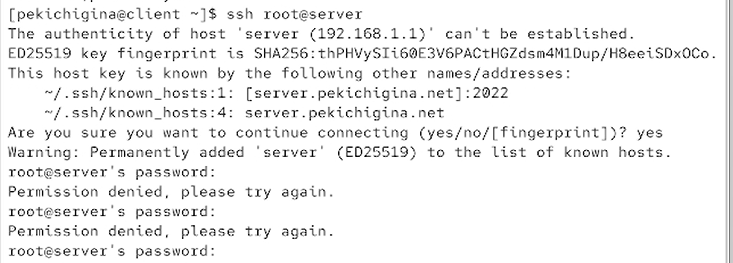
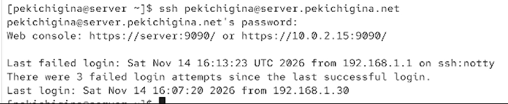
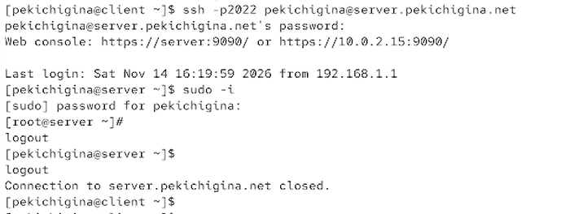
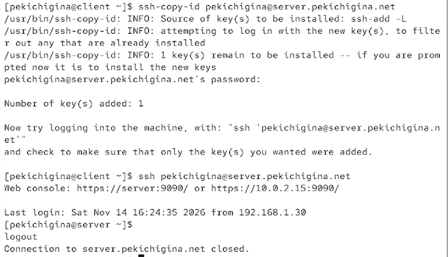
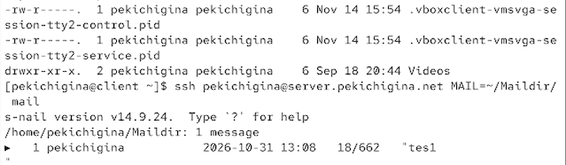

---
## Front matter
title: "Отчёт по лабораторной работе №11"
subtitle: "Отчет"
author: "Кичигина Полина Евгеньевна"

## Generic otions
lang: ru-RU
toc-title: "Содержание"

## Bibliography
bibliography: bib/cite.bib
csl: pandoc/csl/gost-r-7-0-5-2008-numeric.csl

## Pdf output format
toc: true # Table of contents
toc-depth: 2
lof: true # List of figures
lot: true # List of tables
fontsize: 12pt
linestretch: 1.5
papersize: a4
documentclass: scrreprt
## I18n polyglossia
polyglossia-lang:
  name: russian
  options:
	- spelling=modern
	- babelshorthands=true
polyglossia-otherlangs:
  name: english
## I18n babel
babel-lang: russian
babel-otherlangs: english
## Fonts
mainfont: IBM Plex Serif
romanfont: IBM Plex Serif
sansfont: IBM Plex Sans
monofont: IBM Plex Mono
mathfont: STIX Two Math
mainfontoptions: Ligatures=Common,Ligatures=TeX,Scale=0.94
romanfontoptions: Ligatures=Common,Ligatures=TeX,Scale=0.94
sansfontoptions: Ligatures=Common,Ligatures=TeX,Scale=MatchLowercase,Scale=0.94
monofontoptions: Scale=MatchLowercase,Scale=0.94,FakeStretch=0.9
mathfontoptions:
## Biblatex
biblatex: true
biblio-style: "gost-numeric"
biblatexoptions:
  - parentracker=true
  - backend=biber
  - hyperref=auto
  - language=auto
  - autolang=other*
  - citestyle=gost-numeric
## Pandoc-crossref LaTeX customization
figureTitle: "Рис."
tableTitle: "Таблица"
listingTitle: "Листинг"
lofTitle: "Список иллюстраций"
lotTitle: "Список таблиц"
lolTitle: "Листинги"
## Misc options
indent: true
header-includes:
  - \usepackage{indentfirst}
  - \usepackage{float} # keep figures where there are in the text
  - \floatplacement{figure}{H} # keep figures where there are in the text
---

# Цель работы

Приобретение практических навыков по настройке удалённого доступа к серверу
с помощью SSH.

# Задание

1. Настройте запрет удалённого доступа на сервер по SSH для пользователя root.
2. Настройте разрешение удалённого доступа к серверу по SSH только для пользователей группы vagrant и вашего пользователя.
3. Настройте удалённый доступ к серверу по SSH через порт 2022.
4. Настройте удалённый доступ к серверу по SSH по ключу.
5. Организуйте SSH-туннель с клиента на сервер, перенаправив локальное соединение с TCP-порта 80 на порт 8080.
6. Используя удалённое SSH-соединение, выполните с клиента несколько команд на сервере.
7. Используя удалённое SSH-соединение, запустите с клиента графическое приложение на сервере.
8. Напишите скрипт для Vagrant, фиксирующий действия по настройке SSH-сервера
во внутреннем окружении виртуальной машины server. Соответствующим образом
внесите изменения в Vagrantfile.

# Выполнение лабораторной работы

Запрет удалённого доступа по SSH для пользователя root

1. На сервере задайте пароль для пользователя root, если этого не было сделано ранее:
sudo -i
passwd root
2. На сервере в дополнительном терминале запустите мониторинг системных собы-
тий:
sudo -i
journalctl -x -f
3. С клиента попытайтесь получить доступ к серверу посредством SSH-соединения
через пользователя root:
ssh root@server.user.net
В отчёте поясните, что при этом происходит: При попытке входа ssh root@server сервер запрашивает пароль root и после нескольких неверных попыток выдаёт Permission denied. Это значит, что доступ root по SSH пока разрешён на уровне sshd, и защита сводится только к знанию пароля.
4. На сервере откройте файл /etc/ssh/sshd_config конфигурации sshd для редакти-
рования и запретите вход на сервер пользователю root, установив:
PermitRootLogin no
5. После сохранения изменений в файле конфигурации перезапустите sshd:
systemctl restart sshd
6. Повторите попытку получения доступа с клиента к серверу посредством SSH-
соединения через пользователя root:
ssh root@server
В отчёте поясните, что при этом происходит: После установки PermitRootLogin no и перезапуска sshd попытка входа под root завершается отказом ещё до проверки пароля. Прямой удалённый доступ для root запрещён, что снижает риск подбора пароля для самой привилегированной учётной записи.(рис. [-@fig:001])

{#fig:001 width=70%}

Ограничение списка пользователей для удалённого
доступа по SSH

1. С клиента попытайтесь получить доступ к серверу посредством SSH-соединения
через пользователя user (вместо user укажите вашего пользователя):
ssh user@server.user.net
В отчёте поясните, что при этом происходит: При входе пользователем pekichigina сервер запрашивает пароль и после успешного ввода открывает оболочку. По умолчанию sshd разрешает вход всем локальным пользователям с паролем, поэтому доступ этому пользователю не ограничен.
2. На сервере откройте файл /etc/ssh/sshd_config конфигурации sshd на редактиро-
вание и добавьте строку
AllowUsers vagrant
3. После сохранения изменений в файле конфигурации перезапустите sshd:
systemctl restart sshd
4. Повторите попытку получения доступа с клиента к серверу посредством
SSH-соединения через пользователя user:
ssh user@server.user.net
В отчёте поясните, что при этом происходит: После добавления AllowUsers vagrant и перезапуска sshd пользователь pekichigina больше не входит в белый список. Сервер отказывает ему в аутентификации, даже если пароль введён верно, так как AllowUsers разрешает вход только перечисленным учётным записям.
5. В файле /etc/ssh/sshd_config конфигурации sshd внесите следующее изменение:
AllowUsers vagrant user
6. После сохранения изменений в файле конфигурации перезапустите sshd и вновь
попытайтесь получить доступ с клиента к серверу посредством SSH-соединения
через пользователя user.
В отчёте поясните, что при этом происходит: После изменения строки на AllowUsers vagrant pekichigina и перезапуска sshd пользователь снова входит в разрешённый список. Подключение ssh pekichigina@server... снова успешно, что подтверждает работу AllowUsers как белого списка пользователей.(рис. [-@fig:002])

{#fig:002 width=70%}

Настройка дополнительных портов для удалённого
доступа по SSH

1. На сервере в файле конфигурации sshd /etc/ssh/sshd_config найдите строку Port
и ниже этой строки добавьте:
Port 22
Port 2022
Эта запись сообщает процессу sshd о необходимости организации соединения через
два разных порта, что даёт гарантию возможности открыть сеансы SSH, даже если
была сделана ошибка в конфигурации.
2. После сохранения изменений в файле конфигурации перезапустите sshd:
systemctl restart sshd
3. Посмотрите расширенный статус работы sshd:
systemctl status -l sshd
Система должна сообщить вам об отказе в работе sshd через порт 2022. Дополни-
тельно посмотрите сообщения в терминале с мониторингом системных событий.
В отчёте поясните суть системных сообщений: После добавления Port 2022 и перезапуска sshd система сообщает об отказе работы через порт 2022. Причина в том, что SELinux не разрешает sshd прослушивать этот порт (он не размечен как ssh_port_t), а межсетевой экран может блокировать входящие подключения; в журнале появляются соответствующие сообщения об ошибке привязки к порту.
4. Исправьте на сервере метки SELinux к порту 2022:
semanage port -a -t ssh_port_t -p tcp 2022
5. В настройках межсетевого экрана откройте порт 2022 протокола TCP.
6. Вновь перезапустите sshd и посмотрите расширенный статус его работы. Статус
должен показать, что процесс sshd теперь прослушивает два порта.
7. С клиента попытайтесь получить доступ к серверу посредством SSH-соединения
через пользователя user (вместо user укажите вашего пользователя):
ssh user@server.user.net
После открытия оболочки пользователя введите sudo -i для получения доступа
root. Отлогиньтесь от root и вашего пользователя на сервере, введя дважды logout
или используя дважды комбинацию клавиш Ctrl + d .
8. Повторите попытку получения доступа с клиента к серверу посредством
SSH-соединения через пользователя user, указав порт 2022:
ssh -p2022 user@server.user.net
После открытия оболочки пользователя введите sudo -i для получения доступа
root. Отлогиньтесь от root и вашего пользователя на сервере, введя дважды logout
или используя дважды комбинацию клавиш Ctrl + d .(рис. [-@fig:003])

{#fig:003 width=70%}

Настройка удалённого доступа по SSH по ключу

В этом упражнении вы создаёте пару из открытого и закрытого ключей для входа на
сервер.
1. На сервере в конфигурационном файле /etc/ssh/sshd_config задайте параметр,
разрешающий аутентификацию по ключу:
PubkeyAuthentication yes
2. После сохранения изменений в файле конфигурации перезапустите sshd.
3. На клиенте сформируйте SSH-ключ, введя в терминале под пользователем user
(вместо user используйте ваш логин):
ssh-keygen
Когда вас спросят, хотите ли вы использовать кодовую фразу, нажмите Enter , что-
бы использовать установку без пароля. При запросе имени файла, в котором
будет храниться закрытый ключ, примите предлагаемое по умолчанию имя файла
(~/.ssh/id_rsa). Когда вас попросят ввести кодовую фразу, нажмите Enter дважды.
4. Закрытый ключ теперь будет записан в файл ~/.ssh/id_rsa, а открытый ключ за-
писывается в файл ~/.ssh/id_rsa.pub.
5. Скопируйте открытый ключ на сервер, введя на клиенте (вместо user укажите ва-
шего пользователя):
ssh-copy-id user@server.user.net
При запросе введите пароль пользователя на удалённом сервере.
6. Попробуйте получить доступ с клиента к серверу посредством SSH-соединения
(вместо user используйте ваш логин):
ssh user@server.user.net
Теперь вы должны пройти аутентификацию без ввода пароля для учётной записи
удалённого пользователя. Отлогиньтесь с сервера, используя комбинацию клавиш
Ctrl + d .(рис. [-@fig:004])

{#fig:004 width=70%}

Организация туннелей SSH, перенаправление
TCP-портов

1. На клиенте посмотрите, запущены ли какие-то службы с протоколом TCP:
lsof | grep TCP
2. Перенаправьте порт 80 на server.user.net на порт 8080 на локальной машине
(вместо user используйте ваш логин):
ssh -fNL 8080:localhost:80 user@server.user.net
3. Вновь на клиенте посмотрите, запущены ли какие-то службы с протоколом TCP:
lsof | grep TCP
В отчёте прокомментируйте полученную при выводе на экран информацию: После выполнения ssh -fNL 8080:localhost:80 user@server... на клиенте появляется процесс ssh, слушающий локальный TCP-порт 8080 (видно в lsof). Это означает, что подключения к локальному порту 8080 перенаправляются через зашифрованный SSH-туннель на порт 80 удалённого сервера.
4. На клиенте запустите браузер и в адресной строке введите localhost:8080. Убе-
дитесь, что отобразится страница с приветствием «Welcome to the server.user.net
server».(рис. [-@fig:005])

{#fig:005 width=70%}

Запуск консольных приложений через SSH

1. На клиенте откройте терминал под пользователем user (вместо user используйте
ваш логин).
2. Посмотрите с клиента имя узла сервера:
ssh user@server.user.net hostname
3. Посмотрите с клиента список файлов на сервере:
ssh user@server.user.net ls -Al
4. Посмотрите с клиента почту на сервере:
ssh user@server.user.net MAIL=~/Maildir/ mail(рис. [-@fig:006])

{#fig:006 width=70%}

Запуск графических приложений через SSH
(X11Forwarding)

1. На сервере в конфигурационном файле /etc/ssh/sshd_config разрешите отобра-
жать на локальном клиентском компьютере графические интерфейсы X11:
X11Forwarding yes
2. После сохранения изменения в конфигурационном файле перезапустите sshd.
3. Попробуйте с клиента удалённо подключиться к серверу и запустить графическое
приложение, например firefox (вместо user используйте ваш логин):
ssh -YC user@server.user.net firefox(рис. [-@fig:006])

{#fig:006 width=70%}

Внесение изменений в настройки внутреннего
окружения виртуальной машины

1. На виртуальной машине server перейдите в каталог для внесения изменений
в настройки внутреннего окружения /vagrant/provision/server/, создайте в нём
каталог ssh, в который поместите в соответствующие подкаталоги конфигурацион-
ный файл sshd_config:
cd /vagrant/provision/server
mkdir -p /vagrant/provision/server/ssh/etc/ssh
cp -R /etc/ssh/sshd_config /vagrant/provision/server/ssh/etc/ssh/
2. В каталоге /vagrant/provision/server создайте исполняемый файл ssh.sh.
(рис. [-@fig:006])

{#fig:006 width=70%}

3. Для отработки созданного скрипта во время загрузки виртуальной машины server
в конфигурационном файле Vagrantfile необходимо добавить в разделе конфигу-
рации для сервера:
server.vm.provision "server ssh",
type: "shell",
preserve_order: true,
path: "provision/server/ssh.sh"

# Выводы

Мы приобрели практические навыки по настройке удалённого доступа к серверу
с помощью SSH.

# Ответы на контрольные вопросы 

1. Запрет root и разрешение alice: отредактируйте /etc/ssh/sshd_config, установите PermitRootLogin no и AllowUsers alice, затем перезапустите sshd.
2. Несколько портов SSH: добавьте несколько строк Port 22, Port 2222 (каждый порт на отдельной строке) в sshd_config. Это используется для сохранения специального порта для аудита бастионного хоста при одновременном предоставлении пользователям возможности входа, или для разделения различных политик доступа .
3. Параметры фонового туннеля: используйте -f (фоновый режим), -N (не выполнять удалённые команды), -L (локальная переадресация) или -R (удалённая переадресация).
4. Локальная переадресация 5555→80: ssh -L 5555:localhost:80 user@server2.example.com.
5. Разрешение SELinux для порта 2022: выполните semanage port -a -t ssh_port_t -p tcp 2022 .
6. Разрешение порта 2022 в брандмауэре: в зависимости от системы используйте firewall-cmd --permanent --add-port=2022/tcp && firewall-cmd --reload (firewalld) или ufw allow 2022/tcp (ufw) .

