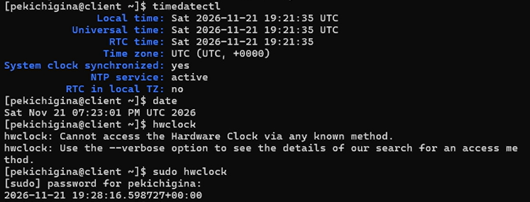
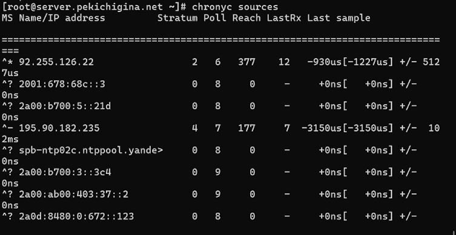
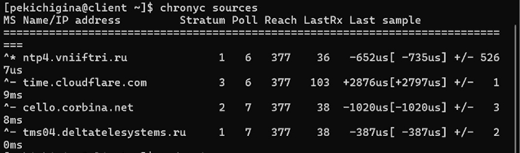
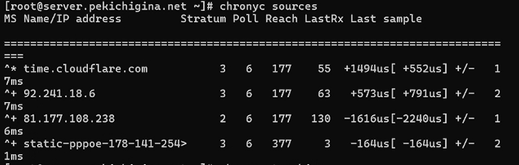
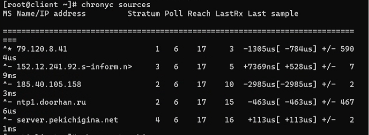
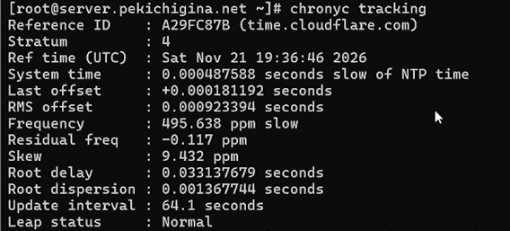
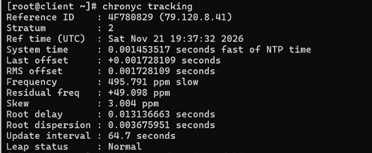
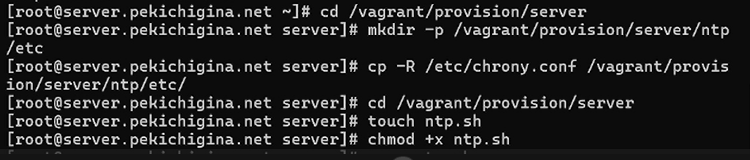

---
## Front matter
lang: ru-RU
title: Лабораторная работа №12
author:
  - Кичигина Полина Евгеньевна
institute:
  - Российский университет дружбы народов, Москва, Россия
date: 21 ноября 2026

## i18n babel
babel-lang: russian
babel-otherlangs: english

## Formatting pdf
toc: false
toc-title: Содержание
slide_level: 2
aspectratio: 169
section-titles: true
theme: metropolis
header-includes:
 - \metroset{progressbar=frametitle,sectionpage=progressbar,numbering=fraction}
---

## Цель работы

Получение навыков по управлению системным временем и настройке синхрониза-
ции времени.

## Задание

1. Изучите команды по настройке параметров времени.
2. Настройте сервер в качестве сервера синхронизации времени для локальной сети.
3. Напишите скрипты для Vagrant, фиксирующие действия по установке и настройке
NTP-сервера и клиента.

## Выполнение лабораторной работы. Настройка параметров времени

1. На сервере и клиенте посмотрите параметры настройки даты и времени,  посмотрите текущее системное время, аппаратное время

{#fig:001 width=70%}

## Управление синхронизацией времени

Проверьте источники времени на клиенте и на сервере.
Синхронизация времени на обоих устройствах работает корректно и стабильно. На сервере и клиенте есть основной источник времени (отмечен звездочкой ^*), а показатель Reach 377 подтверждает, что все последние 8 попыток связи были успешными.

{#fig:002 width=59%}

##

На клиенте используется очень точный сервер ntp4.vniiftri.ru (уровень Stratum 1), а на сервере — IP-адрес 92.255.126.22. Погрешность времени (Last sample) измеряется в микросекундах, что говорит о высокой точности. Строки со знаком ^? на сервере (IPv6-адреса и один домен) означают, что эти серверы недоступны, но на общую синхронизацию это не влияет, так как основное время берется из рабочего источника.

{#fig:003 width=70%}

##

3. На сервере откройте на редактирование файл /etc/chrony.conf и добавьте строку:
allow 192.168.0.0/16. На клиенте откройте файл /etc/chrony.conf и добавьте строку:
server server.user.net iburst. Проверьте источники времени на клиенте и на сервере. Настройка локальной синхронизации прошла успешно. Клиент теперь берет время напрямую с вашего сервера, а сервер — из интернета. 

{#fig:004 width=70%}

##

 Клиент теперь берет время напрямую с вашего сервера, а сервер — из интернета. 
 
{#fig:005 width=70%}

##

 Посмотрите подробную информацию о синхронизации. Сервер синхронизируется с Cloudflare, клиент — с IP 79.120.8.41 (старый источник, chrony ещё не успел переключиться на ваш сервер после перезапуска).

{#fig:006 width=70%}

##

Погрешность (System time): На сервере ~0,4 мс, на клиенте ~1,4 мс. Это отличные показатели.
Статус (Leap status): Normal — синхронизация работает штатно и точно.

{#fig:007 width=70%}

## Внесение изменений в настройки внутреннего окружения виртуальных машин

{#fig:008 width=70%}

## Выводы

Мы получить навыки по управлению системным временем и настройке синхрониза-
ции времени.

