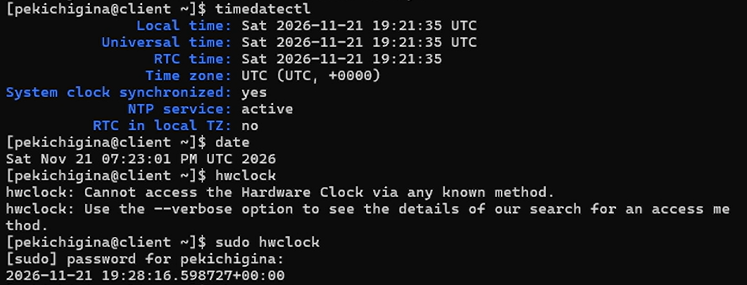
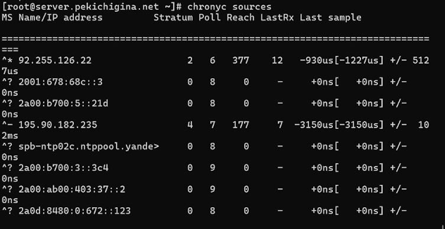
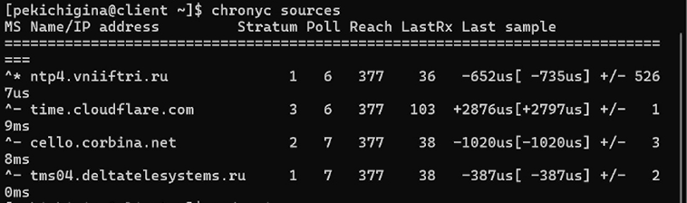
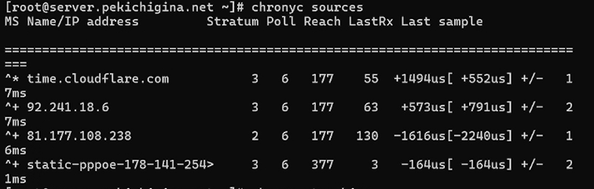
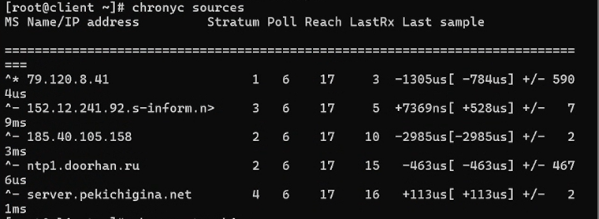
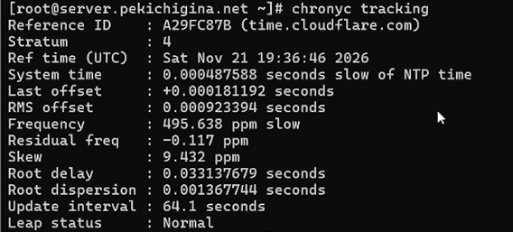
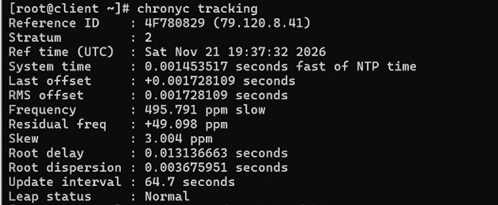
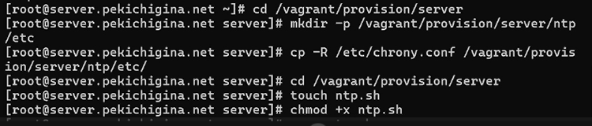

---
## Front matter
title: "Отчёт по лабораторной работе №12"
subtitle: "Отчет"
author: "Кичигина Полина Евгеньевна"

## Generic otions
lang: ru-RU
toc-title: "Содержание"

## Bibliography
bibliography: bib/cite.bib
csl: pandoc/csl/gost-r-7-0-5-2008-numeric.csl

## Pdf output format
toc: true # Table of contents
toc-depth: 2
lof: true # List of figures
lot: true # List of tables
fontsize: 12pt
linestretch: 1.5
papersize: a4
documentclass: scrreprt
## I18n polyglossia
polyglossia-lang:
  name: russian
  options:
	- spelling=modern
	- babelshorthands=true
polyglossia-otherlangs:
  name: english
## I18n babel
babel-lang: russian
babel-otherlangs: english
## Fonts
mainfont: IBM Plex Serif
romanfont: IBM Plex Serif
sansfont: IBM Plex Sans
monofont: IBM Plex Mono
mathfont: STIX Two Math
mainfontoptions: Ligatures=Common,Ligatures=TeX,Scale=0.94
romanfontoptions: Ligatures=Common,Ligatures=TeX,Scale=0.94
sansfontoptions: Ligatures=Common,Ligatures=TeX,Scale=MatchLowercase,Scale=0.94
monofontoptions: Scale=MatchLowercase,Scale=0.94,FakeStretch=0.9
mathfontoptions:
## Biblatex
biblatex: true
biblio-style: "gost-numeric"
biblatexoptions:
  - parentracker=true
  - backend=biber
  - hyperref=auto
  - language=auto
  - autolang=other*
  - citestyle=gost-numeric
## Pandoc-crossref LaTeX customization
figureTitle: "Рис."
tableTitle: "Таблица"
listingTitle: "Листинг"
lofTitle: "Список иллюстраций"
lotTitle: "Список таблиц"
lolTitle: "Листинги"
## Misc options
indent: true
header-includes:
  - \usepackage{indentfirst}
  - \usepackage{float} # keep figures where there are in the text
  - \floatplacement{figure}{H} # keep figures where there are in the text
---

# Цель работы

Получение навыков по управлению системным временем и настройке синхрониза-
ции времени.

# Задание

1. Изучите команды по настройке параметров времени.
2. Настройте сервер в качестве сервера синхронизации времени для локальной сети.
3. Напишите скрипты для Vagrant, фиксирующие действия по установке и настройке
NTP-сервера и клиента.

# Выполнение лабораторной работы

Настройка параметров времени

1. На сервере и клиенте посмотрите параметры настройки даты и времени:
timedatectl
Определите, в какой временной зоне находятся сервер и клиент, проводится ли
сетевая синхронизация времени и т.п. Поэкспериментируйте с параметрами этой
команды.
2. На сервере и клиенте посмотрите текущее системное время:
date
Поэкспериментируйте с параметрами этой команды.
3. На сервере и клиенте посмотрите аппаратное время:
hwclock (рис. [-@fig:001]).

{#fig:001 width=70%}

Управление синхронизацией времени

1. При необходимости установите на сервере необходимое программное обеспечение:
dnf -y install chrony
2. Проверьте источники времени на клиенте и на сервере:
chronyc sources
В отчёте поясните выведенную информацию: Синхронизация времени на обоих устройствах работает корректно и стабильно. На сервере и клиенте есть основной источник времени (отмечен звездочкой ^*), а показатель Reach 377 подтверждает, что все последние 8 попыток связи были успешными.

На клиенте используется очень точный сервер ntp4.vniiftri.ru (уровень Stratum 1), а на сервере — IP-адрес 92.255.126.22. Погрешность времени (Last sample) измеряется в микросекундах, что говорит о высокой точности. Строки со знаком ^? на сервере (IPv6-адреса и один домен) означают, что эти серверы недоступны, но на общую синхронизацию это не влияет, так как основное время берется из рабочего источника. (рис. [-@fig:002])(рис. [-@fig:003])

{#fig:002 width=70%}

{#fig:003 width=70%}

3. На сервере откройте на редактирование файл /etc/chrony.conf и добавьте строку:
allow 192.168.0.0/16
4. На сервере перезапустите службу chronyd:
systemctl restart chronyd
5. Настройте межсетевой экран на сервере:
firewall-cmd --add-service=ntp --permanent
firewall-cmd --reload
6. На клиенте откройте файл /etc/chrony.conf и добавьте строку (вместо user укажите
свой логин):
server server.user.net iburst
Удалите все остальные строки с директивой server.
7. На клиенте перезапустите службу chronyd:
systemctl restart chronyd
8. Проверьте источники времени на клиенте и на сервере:
chronyc sources
В отчёте поясните выведенную информацию: Настройка локальной синхронизации прошла успешно. Клиент теперь берет время напрямую с вашего сервера, а сервер — из интернета. (рис. [-@fig:004])(рис. [-@fig:005])

{#fig:004 width=70%}

{#fig:005 width=70%}

9. Посмотрите подробную информацию о синхронизации и поясните в отчёте выве-
денную на экран информацию: Источник (Reference ID): Сервер синхронизируется с Cloudflare, клиент — с IP 79.120.8.41 (старый источник, chrony ещё не успел переключиться на ваш сервер после перезапуска).

Погрешность (System time): На сервере ~0,4 мс, на клиенте ~1,4 мс. Это отличные показатели.

Статус (Leap status): Normal — синхронизация работает штатно и точно. (рис. [-@fig:006])(рис. [-@fig:007])

{#fig:006 width=70%}

{#fig:007 width=70%}

Внесение изменений в настройки внутреннего
окружения виртуальных машин

1. На виртуальной машине server перейдите в каталог для внесения изменений
в настройки внутреннего окружения /vagrant/provision/server/, создайте в нём
каталог ntp, в который поместите в соответствующие подкаталоги конфигурацион-
ные файлы:
cd /vagrant/provision/server
mkdir -p /vagrant/provision/server/ntp/etc
cp -R /etc/chrony.conf /vagrant/provision/server/ntp/etc/
2. В каталоге /vagrant/provision/server создайте исполняемый файл ntp.sh:
cd /vagrant/provision/server
touch ntp.sh
chmod +x ntp.sh
Открыв его на редактирование, пропишите в нём  скрипт.(рис. [-@fig:008])

{#fig:008 width=70%}

3. На виртуальной машине client перейдите в каталог для внесения изменений
в настройки внутреннего окружения /vagrant/provision/client/, создайте в нём
каталог ntp, в который поместите в соответствующие подкаталоги конфигурацион-
ные файлы:
cd /vagrant/provision/client
mkdir -p /vagrant/provision/client/ntp/etc
cp -R /etc/chrony.conf /vagrant/provision/client/ntp/etc/
4. В каталоге /vagrant/provision/client создайте исполняемый файл ntp.sh:
cd /vagrant/provision/client
touch ntp.sh
chmod +x ntp.sh
Открыв его на редактирование, пропишите в нём следующий скрипт.
5. Для отработки созданных скриптов во время загрузки виртуальных машин server
и client в конфигурационном файле Vagrantfile необходимо добавить в соответ-
ствующих разделах конфигураций для сервера и клиента.

# Выводы

Мы получить навыки по управлению системным временем и настройке синхрониза-
ции времени.

# Ответы на контрольные вопросы 

1. Для согласованности данных и правильного порядка транзакций в распределённых системах.
2. Kerberos использует временные метки для защиты от replay-атак; при расхождении часов более чем на ~5 минут аутентификация не пройдёт.
3. chronyd.
4. Страта 10.
5. UDP 123.
6. `local stratum 10`.
7. Страта 16.
8. `chronyc sources`.
9. `chronyc tracking`.
