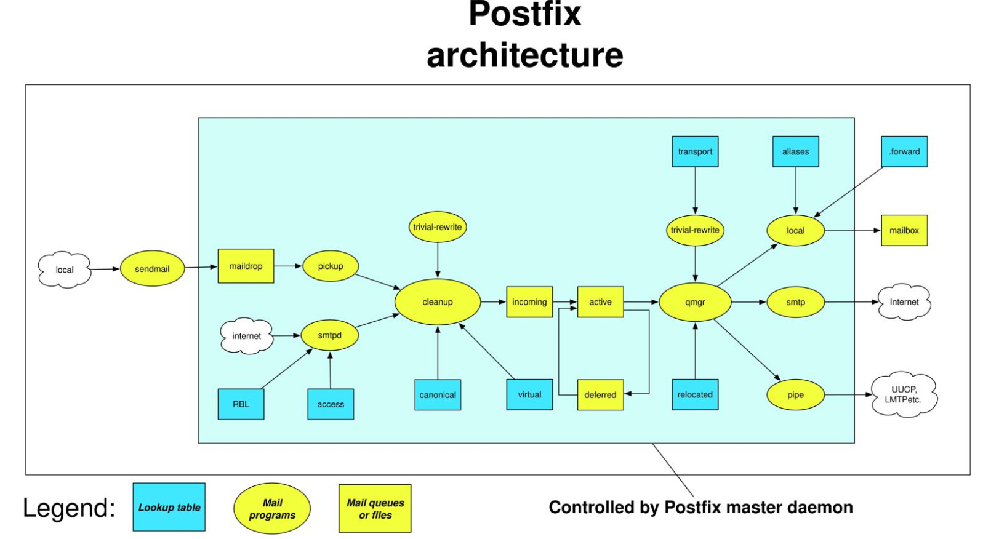

---
## Front matter
lang: ru-RU
title: "SMTP-сервер Postfix"
author:
  - Кичигина Полина Евгеньевна НПИбд-01-24
institute:
  - Российский университет дружбы народов, Москва, Россия
date: 20 ноября 2026

## i18n babel
babel-lang: russian
babel-otherlangs: english

## Formatting pdf
toc: false
toc-title: Содержание
slide_level: 2
aspectratio: 169
section-titles: true
theme: metropolis
header-includes:
 - \metroset{progressbar=frametitle,sectionpage=progressbar,numbering=fraction}
---

## Введение

Postfix — это программа, которая отвечает за приём, обработку и отправку электронной почты. Она появилась как альтернатива Sendmail. Разработчики хотели сохранить совместимость с существующими почтовыми системами, но при этом сделать программу более безопасной и удобной в обслуживании. Для этого в Postfix использовали модульную архитектуру, где разные задачи выполняют отдельные процессы.

## Модульная архитектура Postfix

- Система состоит из множества отдельных процессов.
- Каждый процесс выполняет свою задачу.
- Процессы взаимодействуют через UNIX-сокеты и FIFO.
- Сбой одного компонента не должен приводить к отказу всей системы.

## Основные процессы Postfix

{#fig:001 width=90%}

##  Как проходит обработка письма?

**Приём письма —**`smtpd`

\/

**Обработка —**`cleanup`

\/

**Очередь —**`incoming`

\/

**Управление —**`qmgr`

\/

**Доставка —**`smtp`, `local` или `virtual`

## Управление очередями

{#fig:002 width=60%}

## Безопасность Postfix

- Разделение процессов и изоляция сбоев.
- Минимальные привилегии пользователей и процессов.
- Использование среды `chroot`.
- Защита данных при помощи TLS.
- Поддержка аутентификации SASL.
- Проверка и фильтрация входящих данных.

## Практическое управление сервером

| Команда          | Назначение                           |
| ---------------- | ------------------------------------ |
| `postfix start`  | Запуск Postfix                       |
| `postfix stop`   | Остановка Postfix                    |
| `postfix reload` | Перезагрузка конфигурации            |
| `postfix flush`  | Повторная попытка отправки писем     |
| `newaliases`     | Обновление базы почтовых псевдонимов |

## Postfix и другие почтовые серверы

| Почтовый сервер | Особенности                                             |
| --------------- | ------------------------------------------------------- |
| **Postfix**     | Безопасность, модульная архитектура, удобство настройки |
| **Sendmail**    | Традиционная система с монолитной архитектурой          |
| **qmail**       | Изоляция процессов, более строгая иерархия              |

## Вывод

Postfix — это не просто программа для отправки электронной почты, а полноценная система обработки почтовых сообщений. Её основные преимущества — разделение процессов, эффективное управление очередями и многоуровневая защита. Именно сочетание этих механизмов позволяет Postfix оставаться востребованным решением для организации почтовой инфраструктуры. Спасибо за внимание!

